# AUDIT FONCTIONNEL COMPLET
# APPLICATION : SUIVI DES CARRIÈRES
### MINISTÈRE DU COMMERCE ET DE L'INDUSTRIE — RÉPUBLIQUE DU TCHAD

---

## 1. Informations générales

| Paramètre | Valeur constatée |
| :--- | :--- |
| **Nom officiel de l'application** | Suivi des Carrières (dénomination technique antérieure : PRIMATECH / Career Host V2) |
| **Institution bénéficiaire** | Ministère du Commerce et de l'Industrie — République du Tchad |
| **Date de réalisation de l'audit** | Novembre 2026 |
| **Version audité du code source** | Branche `master` — Commit `c76a1a7` (*style(auth): refonte CSS du login et retrait des mentions institutionnelles superflues*) |
| **Cadre de la mission** | Audit fonctionnel indépendant en lecture seule, confrontation code source vs PRD cible (`PRD_FINAL.md`) |
| **Rôles de l'auditeur** | Architecte logiciel senior, Business Analyst, Expert fonctionnel SIRH, Expert Symfony 7 / Doctrine 3, Auditeur de systèmes d'information administratifs |
| **Règle absolue d'engagement** | Mode strict observation et documentation. Aucune modification de code, aucune migration, aucune altération de données. |
| **Emplacement du livrable** | `docs/audits/AUDIT_FONCTIONNEL_COMPLET.md` |

---

## 2. Résumé exécutif

Cet audit a été conduit de manière rigoureuse et exhaustive en examinant l'intégralité du code source du projet **Suivi des Carrières** (hébergé sur le dépôt local `career_host`). L'objectif a consisté à vérifier la réalité opérationnelle de chaque brique applicative face aux exigences formulées dans le document directeur `PRD_FINAL.md`.

### 2.1. Indicateurs clés de l'audit

| Indicateur | Valeur chiffrée | Modalité de calcul / Justification |
| :--- | :---: | :--- |
| **Périmètre des domaines examinés** | **19 modules** | 18 modules du PRD (Modules 00 à 18) + Module Visiteurs hérité |
| **Exigences fonctionnelles auditées** | **88 items** | Inventaire exhaustif des capacités attendues selon le PRD |
| **Fonctionnalités IMPLÉMENTÉES** | **49 items** (55,7 %) | Fonctionnalité attestée par entités, services, contrôleurs, templates et tests |
| **Fonctionnalités PARTIELLES** | **23 items** (26,1 %) | Brique développée mais incomplète (ex: formulaire sans liaison, workflow tronqué) |
| **Fonctionnalités NON IMPLÉMENTÉES** | **11 items** (12,5 %) | Brique requise par le PRD mais totalement absente du code (ex: notifications, API) |
| **Fonctionnalités NON FONCTIONNELLES** | **5 items** (5,7 %) | Code présent mais inopérant (ex: export employé renvoyant l'index, rôles déconnectés) |
| **Fonctionnalités NON VÉRIFIÉES** | **0 item** (0,0 %) | Toutes les fonctionnalités ont été investiguées au niveau du code |
| **Anomalies formellement qualifiées** | **32 anomalies** | Réparties en 4 CRITIQUES, 10 ÉLEVÉES, 12 MOYENNES, 6 FAIBLES |
| **Score global de conformité pondéré** | **68,8 %** | Formule : $\frac{\text{Implémentées} + (0.5 \times \text{Partielles})}{\text{Total Exigences}} = \frac{49 + 11.5}{88}$ |
| **Niveau de maturité fonctionnelle** | **Niveau 3 — Transitoire Avancé** | Socle métier V2 et workflows administratifs riches, mais rupture sur les API et la notification |

### 2.2. Synthèse managériale des forces et faiblesses

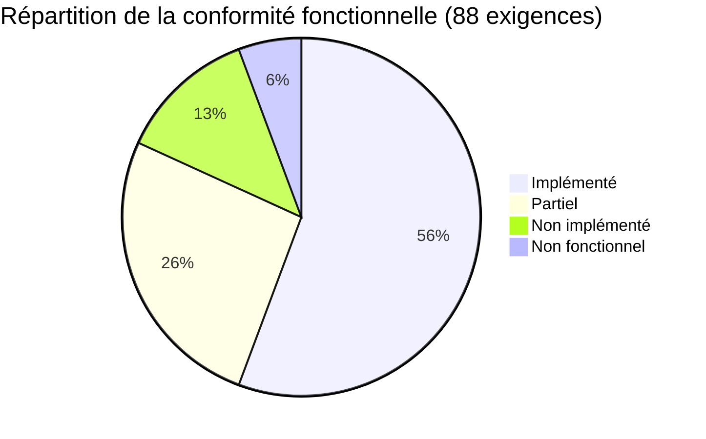

#### Les points forts avérés
1. **Socle multi-tenant hautement étanche (Module 02) :** Implémentation exemplaire d'un `TenantFilter` Doctrine fail-closed combiné à un `TenantContext` et à 15 Voters de sécurité Symfony. Les risques d'IDOR (Insecure Direct Object Reference) inter-institutions sont bloqués dès le niveau DQL/SQL pour 19 classes d'entités.
2. **Workflows administratifs et carrière avancés (Modules 05, 06, 08, 09, 10, 11, 12) :** L'application dispose de machines à états métiers robustes gérées par des services dédiés (`CarriereService`, `PosteService`, `ActeService`, `CongeService`, `AbsenceService`, `MissionService`, `InterimService`).
3. **Sécurisation des accès et IAM (Module 01) :** Double authentification TOTP fonctionnelle avec codes de secours (8 codes chiffrés SHA-256), limitation de débit (*Rate Limiting*) sur les tentatives de connexion et de réinitialisation, traçabilité des événements de sécurité dans `SecurityAuditLog`.
4. **Gestion documentaire robuste (Module 07) :** Stockage sécurisé des fichiers physiques hors de la racine Web avec arborescence partitionnée par institution (`tenant_{id}`), hachage d'intégrité SHA-256, versionnement incrémental et streaming HTTP protégé contre le reniflage de type MIME.
5. **Ergonomie et responsive design (Module 19 / UX) :** Interface Metronic v8 soignée, adaptée aux armoiries et couleurs du Ministère du Commerce et de l'Industrie du Tchad, couplée à une suite automatisée de tests responsive Playwright validée sur 10 résolutions d'écran sans débordement horizontal.

#### Les défaillances et retards majeurs
1. **Absence complète du sous-système de Notifications (Module 15) :** Aucune entité de notification, aucun centre de notification utilisateur (in-app), aucun déclencheur d'email lors des transitions d'états (approbation de congé, ordre de mission, affectation). Le seul composant d'envoi d'email actif est réservé à la réinitialisation de mot de passe.
2. **Incompatibilité totale avec le client mobile / API absente (Module 18) :** Le répertoire `src/Controller/API` est strictement vide. Aucun pare-feu JWT n'est configuré dans `security.yaml` malgré la présence des bundles dans `composer.json`. L'unique route d'API existante est un helper interne pour formulaires dynamiques (`/api/services/{institutionId}`).
3. **Confusion structurelle entre `User` et `Employe` (Module 04 / ANO-001) :** Lors de la création d'un employé dans `EmployeController::new()`, le code affecte automatiquement l'administrateur RH connecté comme "User" de l'employé (`$employe->setUser($currentUser)`). Cela lie tous les employés d'un service au compte de l'administrateur créateur, interdisant aux véritables agents de posséder leur propre compte utilisateur pour soumettre leurs demandes en libre-service.
4. **Redondance et déconnexion dans le module Pointage & Présence (Module 13 / ANO-002) :** Coexistence non résolue entre deux entités concurrentes : `Pointage` et `Presence`. Le pointage reste une saisie manuelle administrative sur formulaire Twig, sans QR code, sans pointeuse mobile et sans réconciliation automatique avec les congés ou missions validés.
5. **Données résiduelles et éléments mockés (Module 17 / ANO-003) :** Présence de valeurs fictives codées en dur (`[5, 12, 3, 1]`) en cas d'absence de données dans le graphique des congés de `StatsController`, et mention par défaut de "Côte d'Ivoire" comme pays de destination dans `MissionService`.

---

## 3. Méthodologie d'audit

L'audit a appliqué une démarche d'investigation systématique dite **"Zero Assumption"** : la présence d'une classe, d'une entité ou d'une vue ne constitue en aucun cas la preuve de son bon fonctionnement opérationnel.

### 3.1. Niveaux de qualification des constats

Chaque élément audité est qualifié selon quatre niveaux stricts :
- **Fait vérifié :** Le mécanisme est implémenté, les liaisons entre entité, repository, service, formulaire, contrôleur et vue sont effectives, et la cohérence de l'exécution est démontrée par le code ou un test.
- **Indice technique :** Des composants existent (ex: entité Doctrine ou vue Twig), mais le câblage fonctionnel est incomplet ou non opérationnel.
- **Hypothèse :** Une déduction sur l'intention du développeur qui nécessite une confirmation métier mais n'est pas formalisée dans le code.
- **Non vérifiable :** Fonctionnalité dépendant d'un composant d'infrastructure externe non disponible dans l'environnement d'audit (ex: serveur SMTP sortant actif, base de données relationnelle en direct).

### 3.2. Outils et techniques d'inspection mobilisés
- **Exploration statique et structurelle :** Cartographie du graphe de dépendances via AST Graphify (2 226 nœuds, 5 788 arcs).
- **Inspection de configuration Symfony :** Commande `php bin/console debug:router` (156 routes inspectées), analyse des attributs PHP 8.4, analyse des fichiers `config/packages/*.yaml`.
- **Analyse du modèle de données :** Comparaison des entités Doctrine ORM 3.2 avec les 13 fichiers de migration SQL du répertoire `migrations/`.
- **Inspection des règles de gestion :** Dépouillement exhaustif des méthodes des 12 services métier de `src/Service/`.
- **Vérification des habilitations :** Analyse des 15 Voters de `src/Security/Voter/` et de la hiérarchie des rôles de `security.yaml`.
- **Inspection UI / UX :** Dépouillement des templates Twig de `templates/`, des contrôleurs Stimulus de `assets/controllers/` et de la suite Playwright `tests/visual/test_responsive.py`.

---

## 4. Périmètre inspecté

Le tableau ci-dessous récapitule l'ensemble des éléments analysés dans le code source :

| Composant | Volume identifié | Détail |
| :--- | :---: | :--- |
| **Entités Doctrine** | 35 classes | `src/Entity/*.php` |
| **Contrôleurs Web & API** | 27 classes | `src/Controller/*.php` (dont `API/` vide) |
| **Services métier** | 12 classes | `src/Service/*.php` |
| **Voters de sécurité** | 15 classes | `src/Security/Voter/*.php` |
| **Formulaires (FormTypes)** | 26 classes | `src/Form/*.php` |
| **Repositories** | 34 classes | `src/Repository/*.php` |
| **Migrations SQL** | 13 fichiers | `migrations/Version*.php` |
| **Commandes Console** | 4 classes | `src/Command/*.php` |
| **Event Subscribers** | 2 classes | `src/EventSubscriber/` et `src/MultiTenancy/EventListener/` |
| **Dossiers de templates Twig** | 27 répertoires | `templates/*` |
| **Routes applicatives** | 156 routes | Déclarées par attributs de routage |
| **Tests PHPUnit** | 145 méthodes | `tests/*` (21 classes de test) |
| **Tests automatisés Responsive** | 200 checkpoints | `tests/visual/test_responsive.py` (Playwright) |

---

## 5. Architecture technique constatée

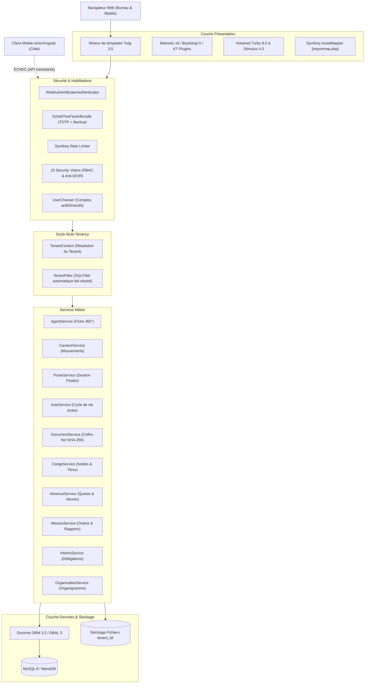

### 5.1. Stack logicielle détaillée
- **Langage & Runtime :** PHP 8.4.1 (CLI et FPM).
- **Framework backend :** Symfony 7.1.*.
- **ORM & Persistance :** Doctrine ORM 3.2, Doctrine DBAL 3, Doctrine Migrations Bundle 3.3.
- **Base de données configurée :** MySQL (`mysql://root@127.0.0.1:3306/primatech` dans `.env`). La cible PostgreSQL spécifiée dans le PRD n'a pas été configurée dans l'environnement existant.
- **Moteur de templates :** Twig 3.0 avec Twig Extra Bundle.
- **Design System & UI :** Metronic v8 adapté en Bootstrap 5 avec classes personnalisées aux couleurs du Tchad (`--mci-blue: #002664`, `--mci-gold: #c69214`, `--mci-red: #c8102e`).
- **Gestion des assets :** Hybride Symfony AssetMapper (`importmap.php`) et Webpack Encore (`package.json`).
- **JavaScript & Interactivité :** Hotwired Turbo 8.0, Stimulus Bridge 4.0, Symfony UX Chart.js, DataTables BS5.
- **Composants d'authentification :** Symfony Security Bundle, Authenticator personnalisé `WebAuthentificatorAuthenticator`, `UserChecker`.
- **MFA :** `scheb/2fa-bundle`, `scheb/2fa-totp`, `scheb/2fa-backup-code`.
- **Protection anti-bruteforce :** `symfony/rate-limiter` (5 requêtes / minute pour réinitialisation de mot de passe et tentative de connexion).
- **Gestion documentaire :** Service maison `DocumentService` avec hachage SHA-256 et streaming sécurisé. `vich/uploader-bundle` est présent dans `composer.json` mais n'est pas utilisé pour les documents RH V2.
- **API REST :** `lexik/jwt-authentication-bundle` et `friendsofsymfony/rest-bundle` sont installés dans `composer.json` mais **inactifs et non configurés** dans `security.yaml`.

---

## 6. Cartographie des modules

L'audit a permis d'établir la cartographie exhaustive des 19 modules identifiés :

| Réf. Module | Nom du module | Objectif métier | Entités associées | Contrôleurs | Services métier | Statut d'implémentation |
| :---: | :--- | :--- | :--- | :--- | :--- | :---: |
| **MOD-00** | Stabilisation & Socle | Élimination des erreurs 500 et socle technique | Toutes | Tous | Tous | **IMPLÉMENTÉ** |
| **MOD-01** | IAM & Authentification | Comptes, connexion, 2FA, réinitialisation, audit | `User`, `PasswordResetToken`, `SecurityAuditLog` | `SecurityController`, `AccountSecurityController`, `PasswordResetController`, `UserController` | `PasswordResetService`, `SecurityAuditService` | **IMPLÉMENTÉ** |
| **MOD-02** | Multi-Tenancy | Partitionnement strict des données par institution | `Institution`, `TenantAwareInterface` | Tous contrôleurs via filtre | `TenantContext`, `TenantFilter` | **IMPLÉMENTÉ** |
| **MOD-03** | Organisation & Structures | Cartographie hiérarchique, services, organigramme | `Institution`, `TypeInstitution`, `Structure`, `Service`, `OrganisationHistory` | `InstitutionController`, `TypeInstitutionController`, `StructureController`, `ServiceController`, `OrganigrammeController` | `OrganisationService` | **IMPLÉMENTÉ** |
| **MOD-04** | Gestion des agents | Fiche agent 360°, état civil, carrière tchadienne | `Employe` | `EmployeController` | `AgentService` | **PARTIEL** (Liaison User défaillante) |
| **MOD-05** | Gestion des postes | Catalogue des postes, vacance, occupation | `Poste`, `OccupationPoste`, `Fonction` | `PosteController`, `FonctionController` | `PosteService` | **IMPLÉMENTÉ** |
| **MOD-06** | Carrière & Affectations | Mouvements, mutations, promotions, cessations | `Affectation` | `AffectationController` | `CarriereService` | **IMPLÉMENTÉ** |
| **MOD-07** | Documents RH | Coffre-fort documentaire, intégrité, versions | `Document`, `DocumentVersion` | `DocumentController` | `DocumentService` | **IMPLÉMENTÉ** |
| **MOD-08** | Actes administratifs | Référentiel juridique, arrêtés, décisions, filiation | `Acte`, `TypeActe` | `ActeController` | `ActeService` | **IMPLÉMENTÉ** |
| **MOD-09** | Congés | Demandes, décompte, déduction solde, titres | `Conges`, `CongesLog`, `TypeConges`, `SoldeConge` | `CongesController` | `CongeService` | **IMPLÉMENTÉ** |
| **MOD-10** | Autorisations d'absence | Absences courtes, quotas annuels, décompte heures | `Absence`, `AbsenceLog`, `TypeAbsence` | `AbsenceController` | `AbsenceService` | **IMPLÉMENTÉ** |
| **MOD-11** | Missions | Ordres de mission, participants, rapports | `Mission`, `MissionParticipant`, `MissionLog` | `MissionController` | `MissionService` | **IMPLÉMENTÉ** |
| **MOD-12** | Intérims | Continuité de service, délégations temporaires | `Interim`, `InterimLog` | `InterimController` | `InterimService`, `ExpireInterimsCommand` | **IMPLÉMENTÉ** |
| **MOD-13** | Pointage & Présences | Relevé des entrées/sorties et assiduité | `Pointage`, `Presence` | `PointageController`, `PresenceController` | — | **PARTIEL** (Doublon d'entités, saisie manuelle) |
| **MOD-14** | Visiteurs | Gestion des visiteurs externes et accès | `Visite` | `VisiteController` | — | **PARTIEL** (CRUD basique) |
| **MOD-15** | Notifications | Centre d'alertes in-app, emails de workflow | — *(Aucune entité)* | — *(Aucun contrôleur)* | — *(Aucun service)* | **NON IMPLÉMENTÉ** |
| **MOD-16** | Audit & Journalisation | Traçabilité technique et administrative | `SecurityAuditLog`, `OrganisationHistory`, `*Log` | `WebController::log` | `SecurityAuditService` | **PARTIEL** (Pas d'audit CRUD global) |
| **MOD-17** | Dashboard & Pilotage | Indicateurs consolidés et statistiques | — | `DashboardController`, `StatsController` | — | **PARTIEL** (Donnée mockée résiduelle) |
| **MOD-18** | API REST & Mobile | Endpoints pour application mobile Ionic/Angular | — | `ServiceApiController` (1 seul endpoint) | — | **NON IMPLÉMENTÉ** |

---

## 7. Audit fonctionnel détaillé

### 7.1. IAM — Gestion des utilisateurs et des accès (Module 01)

#### 7.1.1. État des lieux et fonctionnalités constatées
- **Authentification web :** Opérationnelle via `App\Security\WebAuthentificatorAuthenticator`. Le formulaire de login (`/login`) prend en charge la protection CSRF (`authenticate`), la mémorisation (*Remember Me* 7 jours), la journalisation des succès et échecs dans `SecurityAuditLog`, ainsi que la protection anti-redirection ouverte (*Open Redirect*).
- **Vérification du statut du compte :** `App\Security\UserChecker` intercepte la phase de pré-authentification et refuse la connexion si `user.isVerified() === false` en levant une `CustomUserMessageAccountStatusException`.
- **Double authentification (MFA / 2FA) :** Gérée de manière autonome par `App\Controller\AccountSecurityController` :
  - Génération de secret TOTP compatible Google Authenticator / FreeOTP (`/account/2fa/setup`).
  - Validation du premier code et activation (`/account/2fa/enable`).
  - Génération de 8 codes de secours aléatoires hachés en SHA-256 dans l'attribut `backupCodes`.
  - Désactivation sécurisée exigeant la confirmation du mot de passe courant (`/account/2fa/disable`).
  - Interception par `scheb/2fa-bundle` lors de la connexion si le compte a activé la 2FA (redirection vers `/2fa`).
- **Réinitialisation de mot de passe :** `App\Controller\PasswordResetController` et `App\Service\PasswordResetService` implémentent un flux complet sécurisé :
  - Limitation de débit via `password_reset.limiter` (5 requêtes par IP).
  - Génération d'un jeton cryptographique aléatoire de 64 caractères hexadécimaux (`bin2hex(random_bytes(32))`) valide 1 heure.
  - Stockage du hachage SHA-256 dans la table `password_reset_token`.
  - Envoi de l'email via `Symfony\Component\Mailer\MailerInterface` aux couleurs du Ministère.
  - Invalidation immédiate après utilisation (`token.setUsedAt()`).
  - Réponse générique pour éviter l'énumération des adresses email des utilisateurs.
- **Contrôle d'accès et Voters :** `App\Security\Voter\UserVoter` gère les attributs `USER_VIEW`, `USER_CREATE`, `USER_EDIT`, `USER_DELETE`, `USER_TOGGLE_STATUS`. Il interdit formellement à un utilisateur de se supprimer ou de désactiver son propre compte.

#### 7.1.2. Preuves dans le code source
- Authenticator : `src/Security/WebAuthentificatorAuthenticator.php#L42-L89`
- UserChecker : `src/Security/UserChecker.php#L12-L24`
- MFA Controller : `src/Controller/AccountSecurityController.php#L68-L177`
- PasswordResetService : `src/Service/PasswordResetService.php#L40-L115`
- UserVoter : `src/Security/Voter/UserVoter.php#L39-L138`
- Tests associés : `tests/Security/AuthenticationTest.php`, `tests/Security/MfaTest.php`, `tests/Security/PasswordTest.php`, `tests/Security/RateLimitingTest.php`.

#### 7.1.3. Écarts et anomalies identifiés
> [!WARNING] **Anomalie ANO-004 (Élevée) — Déconnexion complète de l'entité `Role` :**
> L'entité Doctrine `App\Entity\Role` (`src/Entity/Role.php`) et son contrôleur associé `App\Controller\RoleController.php` ne sont reliés à aucune autre entité dans le schéma Doctrine. L'entité `User` stocke ses rôles dans un champ JSON natif `User::$roles`. En conséquence, créer, éditer ou supprimer des rôles dans l'interface `/admin/role` n'a **strictement aucun impact** sur les droits des utilisateurs ni sur la sécurité de l'application.

---

### 7.2. Organisations et structures (Module 03)

#### 7.2.1. État des lieux et fonctionnalités constatées
- **Modélisation de l'organigramme :** Le modèle d'organisation administrative repose sur quatre entités coordonnées :
  - `Institution` : L'entité racine du tenant (ex: Ministère du Commerce et de l'Industrie).
  - `TypeInstitution` : Typologie des institutions (Ministère, Institution républicaine, Établissement public).
  - `Structure` : Les entités administratives hiérarchisées (Direction Générale, Direction, Division, Département, Délégation Provinciale). Elle supporte une relation parent/enfants autoréférencée.
  - `Service` : Les cellules opérationnelles rattachées soit directement à l'institution, soit à une `Structure`.
- **Validation anti-cycle et cohérence hiérarchique :** `App\Service\OrganisationService::validateParentStructure()` inspecte récursivement la chaîne des ancêtres lors de l'assignation d'une structure parente pour empêcher tout cycle hiérarchique direct ou indirect.
- **Rattachement des responsables :** `OrganisationService::validateResponsable()` vérifie que le responsable désigné (`Employe`) appartient strictement à la même institution que la structure concernée.
- **Organigramme interactif :** `App\Controller\OrganigrammeController` fournit :
  - Une interface Web de visualisation (`/admin/organigramme`).
  - Un point d'entrée JSON hiérarchique complet (`/admin/organigramme/data`) sérialisant l'arbre avec identification des structures, services, effectifs et responsables.
- **Traçabilité organisationnelle :** Toute modification de structure ou de service est consignée dans l'entité `OrganisationHistory` par `OrganisationService::logChange()`.

#### 7.2.2. Preuves dans le code source
- Détection de cycle : `src/Service/OrganisationService.php#L38-L76`
- Construction de l'arbre JSON : `src/Service/OrganisationService.php#L125-L225`
- Contrôleur Organigramme : `src/Controller/OrganigrammeController.php#L20-L80`
- Voters : `src/Security/Voter/StructureVoter.php`, `src/Security/Voter/ServiceVoter.php`, `src/Security/Voter/InstitutionVoter.php`.
- Tests associés : `tests/Organisation/StructureTest.php`, `tests/Organisation/OrganigrammeTest.php`.

#### 7.2.3. Écarts et anomalies identifiés
> [!NOTE] **Observation fonctionnelle :** Le cloisonnement des délégations provinciales et des structures déconcentrées est pris en charge au niveau de la typologie des structures (`Structure::TYPE_DIRECTION`), mais il n'existe pas de filtrage géographique automatique pour restreindre un utilisateur local à sa seule délégation provinciale.

---

### 7.3. Gestion des agents (Module 04)

#### 7.3.1. État des lieux et fonctionnalités constatées
- **Attributs administratifs et statutaires tchadiens :** L'entité `App\Entity\Employe` a été enrichie avec les attributs de la fonction publique tchadienne :
  - `matricule` : Identifiant unique de l'agent généré automatiquement sous le format `TRI-YYYY-NNN` (ex: `MIN2026001`).
  - `corps`, `grade`, `echelon`, `categorie`, `regime`.
  - `statut_administratif` (Fonctionnaire, Contractuel, Décisionnaire, Stagiaire, Détaché).
  - `situation_administrative` (Activité, Détachement, Disponibilité, Congé, Suspension, Retraite).
  - `date_embauche`, `date_prise_service`.
- **Fiche Agent 360° :** `App\Service\AgentService::getAgent360View()` rassemble et calcule à la volée l'ensemble des données du dossier individuel :
  - Calcul dynamique de l'âge et de l'ancienneté (années et mois).
  - Score de complétude du dossier individuel (sur 10 critères pondérés).
  - Synthèse des soldes et historiques de congés.
  - Synthèse des autorisations d'absence.
  - Synthèse des missions effectuées et en cours (distinction Chef de mission / Participant).
  - Synthèse des présences, retards et absences du mois.
  - Timeline chronologique consolidée des événements de la carrière.
- **Recherche AJAX d'agents :** Route `/admin/employe/search` renvoyant les suggestions d'agents au format Select2 / JSON pour les formulaires.

#### 7.3.2. Preuves dans le code source
- Entité Employe : `src/Entity/Employe.php#L19-L148`
- Fiche Agent 360° : `src/Service/AgentService.php#L28-L230`
- Complétude du profil : `src/Service/AgentService.php#L485-L515`
- Contrôleur Employe : `src/Controller/EmployeController.php#L20-L245`
- Tests associés : `tests/Agent/Agent360Test.php`, `tests/Entity/EmployeRelationsTest.php`.

#### 7.3.3. Écarts et anomalies identifiés
> [!CAUTION] **Anomalie ANO-001 (CRITIQUE) — Association erronée du User créateur à l'agent créé :**
> Dans `src/Controller/EmployeController.php` (lignes 125-126), lors de la soumission du formulaire de création d'un agent :
> ```php
> $employe->setUser($currentUser);
> $employe->setInstitution($institution);
> ```
> Le système assigne le compte de l'administrateur RH connecté (`$currentUser`) comme étant le compte utilisateur de l'employé créé. En conséquence, tous les agents créés par cet administrateur partagent le même `user_id` dans la table `employe`. L'agent ne dispose d'aucun compte personnel, et la méthode `User::getEmploye()` (`$this->employes->first()`) renvoie toujours le premier employé créé par cet administrateur. Cela empêche tout accès en libre-service de l'agent.

> [!WARNING] **Anomalie ANO-005 (Élevée) — Routes d'export et de présence factices :**
> Dans `src/Controller/EmployeController.php` (lignes 73-88), les routes `/admin/employe/export` et `/admin/employe/presence` se contentent de rendre le template de listing standard `employe/index.html.twig`. Aucun fichier CSV/Excel n'est généré pour l'export, et aucune vue de présence spécifique n'est calculée.

---

### 7.4. Dossier individuel et carrière (Module 04 & 06)

#### 7.4.1. État des lieux et fonctionnalités constatées
- **Timeline de carrière unifiée :** `App\Service\CarriereService::getCarriereTimeline()` agrège les événements historiques d'un employé depuis son recrutement jusqu'à sa situation actuelle :
  - Prise de service initiale.
  - Mutations de service ou de structure.
  - Promotions statutaires.
  - Changements de poste.
  - Détachements et réintégrations.
  - Cessations d'activité.
- **Intégrité des données historiques :** Chaque événement de la timeline conserve la référence de l'acte juridique support, la structure d'origine et la structure d'accueil, le motif et le statut du mouvement.

#### 7.4.2. Preuves dans le code source
- Service Carriere : `src/Service/CarriereService.php#L235-L315`
- Template d'affichage : `templates/employe/show.html.twig#L210-L290`
- Tests associés : `tests/Affectation/CarriereTest.php`.

---

### 7.5. Postes, fonctions et organigramme (Module 05)

#### 7.5.1. État des lieux et fonctionnalités constatées
- **Catalogue des postes :** `App\Entity\Poste` modélise le poste de travail de manière découplée de l'agent :
  - Attributs : `titre`, `code`, `niveau` (Direction, Cadre Supérieur, Cadre, Maîtrise, Exécution), `statut` (Vacant, Occupé, Suspendu, Fermé), `description`, `competencesRequises`.
  - Rattachements organisationnels : `institution`, `structure`, `service`, `fonction`.
- **Traçabilité de l'occupation (`OccupationPoste`) :** `App\Entity\OccupationPoste` historise chaque période d'occupation d'un poste par un agent avec date de début, date de fin, motif (Recrutement, Mutation, Promotion, Intérim) et indicateur d'activité `is_actif`.
- **Atomicité de l'affectation à un poste :** `App\Service\PosteService::affecterAgent()` garantit les règles métier suivantes :
  1. Clôture automatique de l'occupation précédente du poste s'il était occupé.
  2. Clôture de l'éventuelle occupation active de l'agent sur son ancien poste et bascule de l'ancien poste à l'état `VACANT`.
  3. Bascule du nouveau poste à l'état `OCCUPE` avec assignation de l'occupant actuel.
  4. Mise à jour automatique des rattachements de l'employé (`poste`, `structure`, `service`, `fonction`).
- **Fiche Poste 360° :** `PosteService::getPoste360View()` produit la vue complète du poste avec chemin arborescent organisationnel, durée d'occupation courante et historique chronologique de tous les occupants passés.

#### 7.5.2. Preuves dans le code source
- Entité Poste : `src/Entity/Poste.php`
- Entité OccupationPoste : `src/Entity/OccupationPoste.php`
- Service Poste : `src/Service/PosteService.php#L25-L115`
- Fiche Poste 360° : `src/Service/PosteService.php#L135-L195`
- Contrôleur Poste : `src/Controller/PosteController.php`
- Voter : `src/Security/Voter/PosteVoter.php`
- Tests associés : `tests/Poste/PosteTest.php`.

---

### 7.6. Affectations et mouvements (Module 06)

#### 7.6.1. État des lieux et fonctionnalités constatées
- **Cycle de vie des mouvements :** Géré par l'entité `App\Entity\Affectation` et le service `App\Service\CarriereService` selon la machine à états suivante :
  ```mermaid
  stateDiagram-v2
      [*] --> PROPOSEE : Création du mouvement
      PROPOSEE --> VALIDEE : Validation RH / Direction
      PROPOSEE --> ANNULEE : Annulation
      VALIDEE --> ACTIVE : Prise de service effective
      VALIDEE --> ANNULEE : Annulation
      ACTIVE --> CLOTUREE : Nouveau mouvement / Mutation
      ACTIVE --> CLOTUREE : Cessation d'activité
  ```
- **Typologie des mouvements :** Prise en charge des types `AFFECTATION_INITIALE`, `MUTATION`, `PROMOTION`, `CHANGEMENT_POSTE`, `DETACHEMENT`, `REINTEGRATION`, `CESSATION`.
- **Génération automatique de référence :** Chaque affectation reçoit un numéro d'enregistrement unique préfixé selon le type (ex: `MUT-20261103-A1B2C`).
- **Prise de service :** La méthode `CarriereService::confirmerPriseDeService()` active l'affectation, met à jour la date de prise de service de l'agent et invoque `PosteService::affecterAgent()` pour occuper le poste cible.
- **Cessation d'activité :** `CarriereService::enregistrerCessation()` libère le poste occupé, clôture l'affectation active, bascule l'employé en inactif (`$employe->setActif(false)`) et met à jour sa situation administrative (`Employe::SITUATION_RETRAITE` ou `DECES`).

#### 7.6.2. Preuves dans le code source
- Création de mouvement : `src/Service/CarriereService.php#L35-L115`
- Validation : `src/Service/CarriereService.php#L120-L135`
- Prise de service : `src/Service/CarriereService.php#L140-L165`
- Cessation : `src/Service/CarriereService.php#L190-L230`
- Contrôleur : `src/Controller/AffectationController.php`
- Voter : `src/Security/Voter/AffectationVoter.php`
- Tests associés : `tests/Affectation/CarriereTest.php`.

---

### 7.7. Documents administratifs (Module 07)

#### 7.7.1. État des lieux et fonctionnalités constatées
- **Coffre-fort documentaire RH :** Implémenté via les entités `App\Entity\Document` et `App\Entity\DocumentVersion`.
- **Isolation physique et sécurité du stockage :**
  - Les fichiers physiques sont stockés strictement en dehors du répertoire public `public/` dans le répertoire paramétré `%documents_storage_directory%`.
  - Chaque institution dispose de son propre sous-dossier étanche `tenant_{id}/` créé automatiquement par `DocumentService::getTenantStorageDirectory()`.
  - Les noms de fichiers physiques sont anonymisés avec un horodatage et un jeton aléatoire sécurisé de 32 caractères hexadécimaux (ex: `20261103_143000_3f2b1a8c9d0e1f2a3b4c5d6e7f8a9b0c.pdf`).
- **Hachage d'intégrité SHA-256 :** Lors de chaque téléversement, `DocumentService` calcule l'empreinte cryptographique SHA-256 (`hash_file('sha256', ...)`) du fichier et l'enregistre dans `Document::$fichierHash` pour détecter toute altération ultérieure.
- **Versionnement documentaire :** Lors du dépôt d'une nouvelle version sur un document existant, la méthode `DocumentService::uploadNewVersion()` :
  1. Incrémente le numéro de version (`v1` $\rightarrow$ `v2`).
  2. Crée un enregistrement `DocumentVersion` contenant les métadonnées et le fichier physique de la version antérieure.
  3. Met à jour le document principal avec le nouveau fichier.
- **Téléchargement sécurisé en streaming :** La route `/admin/document/{id}/download` passe par `DocumentService::serveDocument()` qui renvoie une `BinaryFileResponse` avec en-têtes stricts (`Content-Disposition: attachment`, `X-Content-Type-Options: nosniff`, `Cache-Control: private`).
- **Filtrage des types MIME :** Liste blanche stricte interdisant tout exécutable (PDF, JPEG, PNG, WEBP, DOCX, XLSX, ODT, ODS, CSV). Taille maximale limitée à 25 Mo.
- **Contrôle d'accès et confidentialité :** `App\Security\Voter\DocumentVoter` restreint l'accès aux documents classés `CONFIDENTIALITE_SECRET` ou `RESTREINT` aux seuls administrateurs ou à l'agent concerné.

#### 7.7.2. Preuves dans le code source
- Téléversement et hachage : `src/Service/DocumentService.php#L65-L160`
- Versionnement : `src/Service/DocumentService.php#L165-L215`
- Streaming sécurisé : `src/Service/DocumentService.php#L240-L260`
- Répertoire tenant : `src/Service/DocumentService.php#L290-L300`
- Contrôleur Document : `src/Controller/DocumentController.php`
- Voter : `src/Security/Voter/DocumentVoter.php`
- Tests associés : `tests/Document/DocumentTest.php`.


---

### 7.8. Actes administratifs (Module 08)

#### 7.8.1. État des lieux et fonctionnalités constatées
- **Modélisation juridique :** L'entité `App\Entity\Acte` et le service `App\Service\ActeService` gèrent le cycle de vie légal des actes administratifs de l'institution :
  - `TypeActe` : Typologie standard pré-paramétrée (Arrêté, Décision, Décret, Note de service, Ordre de mission, Titre de congé, Autorisation d'absence, Décision d'intérim).
  - Propriétés : `numero`, `dateSignature`, `dateEffet`, `datePublication`, `objet`, `signataireQualite`, `signataireNom`, `statut`, `contenuResume`.
  - Liaisons transversales : Possibilité d'associer un acte à un agent (`Employe`), un poste (`Poste`), une structure (`Structure`), une affectation (`Affectation`), et un document numérisé (`Document`).
- **Cycle de vie administratif des actes :**
  ```mermaid
  stateDiagram-v2
      [*] --> PROJET : Élaboration du projet
      PROJET --> SIGNE : Signature par l'autorité
      SIGNE --> NOTIFIE : Notification / Publication officielle
      SIGNE --> MODIFIE : Modification par acte modificatif
      NOTIFIE --> MODIFIE : Modification par acte modificatif
      SIGNE --> ABROGE : Abrogation par acte abrogatif
      NOTIFIE --> ABROGE : Abrogation par acte abrogatif
      PROJET --> ANNULE : Retrait / Annulation
      SIGNE --> ANNULE : Annulation contentieuse
  ```
- **Filiation juridique et traçabilité des modifications :** `Acte` supporte une relation parent/enfants autoréférencée (`acteParent` et `actesModificatifs`). Lors de la création d'un acte modificatif ou abrogatif rattaché à un parent, `ActeService::creerActe()` met automatiquement à jour le statut de l'acte parent à `STATUT_MODIFIE` ou `STATUT_ABROGE` (détecté par la présence du terme "abrog" dans l'objet de l'acte).
- **Association bilatérale avec la carrière :** `ActeService::associerAffectation()` relie l'acte juridique à la mutation ou promotion de l'agent.
- **Sécurisation anti-IDOR :** La méthode privée `ActeService::validerEntitesTenant()` vérifie que toutes les entités associées (agent, poste, structure, affectation, document, acte parent) appartiennent strictement au même tenant.

#### 7.8.2. Preuves dans le code source
- Création d'acte : `src/Service/ActeService.php#L35-L125`
- Cycle de vie : `src/Service/ActeService.php#L170-L200`
- Dissociation et liaison document : `src/Service/ActeService.php#L205-L250`
- Contrôleur Acte : `src/Controller/ActeController.php`
- Voter : `src/Security/Voter/ActeVoter.php`
- Tests associés : `tests/Acte/ActeTest.php`.

#### 7.8.3. Écarts et anomalies identifiés
> [!NOTE] **Observation fonctionnelle :** Le PRD mentionne la génération automatique de QR Code pour sceller les actes administratifs et permettre la vérification publique de leur authenticité. Cette fonctionnalité de signature/QR code visuel sur PDF n'est pas encore développée dans le code existant.

---

### 7.9. Congés (Module 09)

#### 7.9.1. État des lieux et fonctionnalités constatées
- **Refonte intégrale du moteur de congés :** Le module existant a été profondément remanié via `App\Service\CongeService` pour corriger la faille historique de non-décrémentation des soldes :
  ```mermaid
  sequenceDiagram
      autonumber
      actor Agent as Agent / Demandeur
      participant Ctl as CongesController
      participant Svc as CongeService
      participant Vtr as CongesVoter
      participant DB as Base de Données
      actor Sup as Chef / Validateur RH

      Agent->>Ctl: Soumet demande (dates, type, motif, justificatif)
      Ctl->>Svc: demanderConge()
      Svc->>Svc: Contrôle anti-chevauchement (Congés + Absences)
      Svc->>Svc: Contrôle solde disponible si type déductible
      Svc->>DB: Persiste Conges (statut = EN_ATTENTE) + CongesLog
      Ctl-->>Agent: Confirmation demande soumise

      Sup->>Ctl: Approuve la demande (approveAction)
      Ctl->>Vtr: isGranted('CONGES_APPROVE', conge)
      Note over Vtr: Règle anti-auto-approbation :<br/>Le validateur ne peut pas approuver son propre congé
      Ctl->>Svc: approuverConge()
      Svc->>Svc: debiterSolde(employe, type, jours)
      Svc->>Svc: genererActePourConge() -> Titre de congé officiel
      Svc->>DB: MAJ Conges (statut = APPROUVE) + CongesLog + Acte
      Ctl-->>Sup: Congé approuvé, solde débité et Titre généré
  ```
- **Gestion des soldes (`SoldeConge`) :** Chaque employé dispose d'un solde annuel par `TypeConges` avec suivi du `soldeAcquis`, `soldePris` et `solde` restant. Si le solde n'a pas encore été initialisé pour l'année en cours, `CongeService::getSolde()` l'initialise automatiquement à partir du quota légal du type (`TypeConges::$joursParAn`).
- **Contrôle anti-chevauchement strict :** `CongeService::verifierChevauchement()` vérifie l'absence de toute demande concurrente (statut en attente ou approuvé) sur la période, tant dans la table `conges` que dans la table `absence`.
- **Règle de séparation des pouvoirs (Anti-auto-approbation) :** `App\Security\Voter\CongesVoter` et `CongeService::approuverConge()` interdisent formellement à un responsable d'approuver sa propre demande de congé (`$approbateur->getId() === $employe->getUser()->getId()`).
- **Génération automatique du Titre de congé :** Lors de l'approbation, la méthode privée `CongeService::genererActePourConge()` crée automatiquement un `Acte` juridique de type `TITRE_CONGE` référencé `TC-YYYY-NNNN` signé par l'autorité approbatrice.
- **Annulation et régularisation du solde :** L'annulation d'un congé préalablement approuvé (`CongeService::annulerConge()`) recrédite immédiatement le solde de l'agent (`crediterSolde()`) et bascule le Titre de congé associé au statut `STATUT_ANNULE`.
- **Journalisation métier (`CongesLog`) :** Chaque transition (création, approbation, refus, annulation) fait l'objet d'un enregistrement horodaté dans `CongesLog`.

#### 7.9.2. Preuves dans le code source
- Soumission et contrôles : `src/Service/CongeService.php#L45-L135`
- Approbation et débit : `src/Service/CongeService.php#L140-L200`
- Annulation et recrédit : `src/Service/CongeService.php#L225-L270`
- Génération du Titre : `src/Service/CongeService.php#L390-L440`
- Voter : `src/Security/Voter/CongesVoter.php#L42-L130`
- Tests associés : `tests/Conges/CongesTest.php`.

---

### 7.10. Autorisations d'absence (Module 10)

#### 7.10.1. État des lieux et fonctionnalités constatées
- **Prise en charge des absences courtes :** Conçue pour les absences de courte durée ne relevant pas du congé annuel (autorisations d'absence pour convenance personnelle, événements familiaux, examens médicaux, convocations administratives).
- **Entités dédiées :**
  - `TypeAbsence` : Déclare le libelle, le code, l'unité (`JOURS` ou `HEURES`), le `dureeMax` par demande, le `quotaAnnuelMax` cumulé par an, l'obligation de justificatif `justificatifRequis` et la rémunération `remuneree`.
  - `Absence` : Enregistre la demande avec `dateDebut`, `dateFin`, `heureDebut`, `heureFin`, `duree`, `unite`, `motif`, `statut` (En attente, Approuvé, Refusé, Annulé).
  - `AbsenceLog` : Journal d'audit des décisions.
- **Règles métier implémentées dans `AbsenceService` :**
  1. Calcul automatique de la durée en heures ou en jours.
  2. Contrôle anti-chevauchement croisé avec les absences et les congés.
  3. Blocage si la durée dépasse le plafond unitaire (`dureeMax`).
  4. Blocage si le cumul annuel de l'agent dépasse le quota annuel (`quotaAnnuelMax`).
  5. Justificatif obligatoire validé via pièce jointe `Document`.
  6. Règle anti-auto-approbation appliquée au validateur.
  7. Génération automatique de l'acte d'autorisation d'absence (`AA-YYYY-NNNN`).
  8. En cas d'annulation, abrogation de l'acte juridique généré.

#### 7.10.2. Preuves dans le code source
- Service Absence : `src/Service/AbsenceService.php#L45-L215`
- Anti-chevauchement croisé : `src/Service/AbsenceService.php#L240-L275`
- Génération d'acte : `src/Service/AbsenceService.php#L305-L355`
- Contrôleur : `src/Controller/AbsenceController.php`
- Voter : `src/Security/Voter/AbsenceVoter.php`
- Tests associés : `tests/Absence/AbsenceTest.php`.

---

### 7.11. Missions (Module 11)

#### 7.11.1. État des lieux et fonctionnalités constatées
- **Gestion intégrale du cycle de mission :** Implémentée par les entités `Mission`, `MissionParticipant`, `MissionLog` et le service `App\Service\MissionService`.
- **Workflow de mission complet :**
  ```mermaid
  stateDiagram-v2
      [*] --> BROUILLON : Saisie initiale
      BROUILLON --> SOUMISE : Soumission pour validation
      SOUMISE --> VALIDEE : Approbation Direction (Ordre émis)
      SOUMISE --> REFUSEE : Refus avec motif
      VALIDEE --> EN_COURS : Départ effectif
      VALIDEE --> ANNULEE : Annulation (Ordre abrogé)
      EN_COURS --> TERMINEE : Retour de mission
      TERMINEE --> CLOTUREE : Dépôt & validation du rapport
  ```
- **Prise en charge multi-participants :** Une mission comprend un Chef de mission obligatoire et plusieurs agents participants (`MissionParticipant`) avec rôle qualifié (Chef de mission, Participant, Chauffeur, Expert).
- **Vérification de disponibilité croisée :** `MissionService::verifierDisponibiliteAgent()` vérifie pour chaque participant qu'il n'est pas déjà en congé, en absence autorisée ou engagé sur une autre mission active aux mêmes dates.
- **Séparation des fonctions :** `MissionService::verifierNonParticipationValidateur()` interdit formellement à un utilisateur de valider ou de clôturer une mission dont il est le chef ou un participant.
- **Ordre de mission officiel :** Lors de la validation, le système génère un acte officiel `ORDRE_MISSION` référencé `OM-YYYY-NNNN`.
- **Rapport de mission et clôture :** La clôture de la mission requiert le dépôt d'un rapport formalisé (`MissionRapportType`).

#### 7.11.2. Preuves dans le code source
- Création et participants : `src/Service/MissionService.php#L45-L160`
- Validation et Ordre : `src/Service/MissionService.php#L190-L245`
- Dépôt et validation du rapport : `src/Service/MissionService.php#L295-L365`
- Contrôle de disponibilité : `src/Service/MissionService.php#L395-L445`
- Contrôleur : `src/Controller/MissionController.php`
- Voter : `src/Security/Voter/MissionVoter.php`
- Tests associés : `tests/Mission/MissionTest.php`.

#### 7.11.3. Écarts et anomalies identifiés
> [!WARNING] **Anomalie ANO-006 (Moyenne) — Pays par défaut inadapté dans `MissionService` :**
> Dans `src/Service/MissionService.php#L57`, le paramètre `$pays` par défaut est défini sur `'Côte d\'Ivoire'`. Pour une application déployée au Ministère du Commerce et de l'Industrie de la République du Tchad, la valeur par défaut doit être `'Tchad'`.

---

### 7.12. Intérims (Module 12)

#### 7.12.1. État des lieux et fonctionnalités constatées
- **Continuité de service public :** Gérée par `App\Entity\Interim`, `App\Entity\InterimLog` et `App\Service\InterimService`.
- **Règles d'incompatibilité et de validité :**
  1. Le titulaire et l'intérimaire doivent être deux personnes physiques distinctes.
  2. L'intérimaire doit être en situation d'activité (`$interimaire->isActif() === true`).
  3. L'intérimaire ne doit pas avoir de congé, d'absence ou d'autre intérim simultané.
  4. Le titulaire ne peut pas faire l'objet de deux désignations d'intérim chevauchantes.
- **Périmètre et typologie des pouvoirs :** Prise en charge du remplacement total (`TYPE_INTERIM_TOTAL`) ou de la délégation partielle (`TYPE_DELEGATION_SIGNATURE`), avec périmètre d'action paramétrable (Tous pouvoirs, Validation congés, Gestion courante, etc.).
- **Génération automatique de la décision d'intérim :** Lors de la validation, génération d'un acte officiel `DECISION_INTERIM` référencé `DEC-INT-YYYY-NNNN`.
- **Expiration automatique par commande console :** `App\Command\ExpireInterimsCommand` (`php bin/console app:interim:expire`) scanne les intérims actifs dont la date de fin est dépassée et les clôture automatiquement en basculant leur statut à `STATUT_EXPIRE` avec historisation dans `InterimLog`.

#### 7.12.2. Preuves dans le code source
- Création et contrôles : `src/Service/InterimService.php#L45-L140`
- Commande d'expiration automatique : `src/Command/ExpireInterimsCommand.php#L17-L58`
- Contrôleur : `src/Controller/InterimController.php`
- Voter : `src/Security/Voter/InterimVoter.php`
- Tests associés : `tests/Interim/InterimTest.php`.

---

### 7.13. Notifications (Module 15)

#### 7.13.1. État des lieux et fonctionnalités constatées
L'audit complet du code source révèle l'absence de toute infrastructure dédiée aux notifications :
- **Entité Notification :** Absente. Aucune table de stockage des notifications en base.
- **Centre de notifications UI :** Absent. La barre supérieure Metronic (`_header.html.twig`) ne comporte aucun tiroir de notifications fonctionnel.
- **Notifications par email :** Inexistantes sur les workflows métiers. Aucune notification n'est expédiée lors de la soumission, validation ou refus d'un congé, d'une absence, d'une mission ou d'un mouvement d'affectation. Le service `Symfony\Component\Mailer\MailerInterface` n'est injecté que dans `PasswordResetService`.
- **Notifications SMS / Push :** Aucun connecteur ni fournisseur SMS (Twilio, Orange, etc.) n'est configuré.

#### 7.13.2. Preuves dans le code source
- Recherche globale `MailerInterface` dans `src/` : Résultat restreint à `PasswordResetService.php`.
- Recherche globale `Notification` dans `src/` : Résultat restreint à un libellé de formulaire dans `ActeType.php`.

#### 7.13.3. Écarts et anomalies identifiés
> [!CAUTION] **Anomalie ANO-007 (CRITIQUE) — Inexistence totale du module de notifications :**
> Alors que le PRD (Module 15) fait de la notification un pilier de la digitalisation des processus RH (alertes de validation, rappels d'échéance, information des agents sur leurs demandes), aucun dispositif technique n'a été implémenté dans le code.

---

### 7.14. Audit et journalisation (Module 16)

#### 7.14.1. État des lieux et fonctionnalités constatées
Le système propose deux niveaux de journalisation distincts mais complémentaires :
1. **Journal d'audit de sécurité et des accès (`SecurityAuditLog`) :**
   - Entité `App\Entity\SecurityAuditLog` partitionnée par tenant (`TenantAwareInterface`).
   - Journalise les événements d'authentification et d'administration des comptes : `LOGIN_SUCCESS`, `LOGIN_FAILURE`, `LOGOUT`, `PASSWORD_CHANGED`, `PASSWORD_RESET_REQUESTED`, `PASSWORD_RESET_COMPLETED`, `MFA_ENABLED`, `MFA_DISABLED`, `ROLE_CHANGED`, `ACCOUNT_DISABLED`.
   - Enregistre : identifiant utilisateur, adresse IP, User-Agent, horodatage immutable, label et description.
   - Les 10 derniers événements sont consultables directement par l'utilisateur connecté sur son espace sécurité (`/account/security`).
2. **Journaux d'audit métiers spécialisés :**
   - `OrganisationHistory` : Traçabilité des créations/modifications de structures et services.
   - `CongesLog` : Traçabilité chronologique des demandes et décisions de congés.
   - `AbsenceLog` : Traçabilité des autorisations d'absence.
   - `MissionLog` : Traçabilité des étapes de mission.
   - `InterimLog` : Traçabilité des désignations d'intérim.
3. **Interface d'administration des logs :** La route `/log` (`App\Controller\WebController::log`) permet aux administrateurs (`ROLE_ADMIN`) de visualiser les 100 derniers événements de sécurité et les 50 derniers événements de congés.

#### 7.14.2. Preuves dans le code source
- Service d'audit : `src/Service/SecurityAuditService.php`
- Entité SecurityAuditLog : `src/Entity/SecurityAuditLog.php`
- Contrôleur Log : `src/Controller/WebController.php#L20-L35`
- Template Log : `templates/log.html.twig`.

#### 7.14.3. Écarts et anomalies identifiés
> [!WARNING] **Anomalie ANO-008 (Élevée) — Absence d'audit trail CRUD générique :**
> Il n'existe pas d'écouteur Doctrine global (ex: Doctrine Audit / Entity Listener) traçant les créations, modifications et suppressions avec ancienne et nouvelle valeur (`old_value` / `new_value`) sur les entités maîtresses `Employe`, `Poste`, `Document` et `Acte`.

---

### 7.15. Dashboard et reporting (Module 17)

#### 7.15.1. État des lieux et fonctionnalités constatées
- **Dashboard général (`/dashboard`) :** Géré par `App\Controller\DashboardController::index()`. Toutes les métriques sont partitionnées par l'institution de l'utilisateur connecté :
  - Effectif total de l'institution.
  - Nombre de présents aujourd'hui (calculé via `PointageRepository::countPresentsTodayByInstitution`).
  - Nombre d'absents du jour (différence entre effectifs actifs et présents).
  - Nombre de congés en cours et congés en attente.
  - Visites du jour et visites en attente.
  - Taux moyen de présence sur 30 jours.
  - Graphique de présence des 6 derniers mois et répartition des congés par statut.
- **Dashboard d'administration (`/admin/dashboard`) :** Dédié à `ROLE_ADMIN`, présentant les statistiques consolidées par service et l'historique sur 12 mois.
- **Statistiques RH avancées (`/admin/statistique/`) :** Gérées par `App\Controller\StatsController`. Calcule les taux d'absentéisme hebdomadaire et mensuel, l'évolution semestrielle et les top services les plus touchés par l'absentéisme.
- **Export des statistiques :** Route `/admin/statistique/export` générant un export tabulaire basique au format CSV.

#### 7.15.2. Preuves dans le code source
- DashboardController : `src/Controller/DashboardController.php#L22-L78`
- StatsController : `src/Controller/StatsController.php#L38-L150`
- Export CSV : `src/Controller/StatsController.php#L535-L570`.

#### 7.15.3. Écarts et anomalies identifiés
> [!CAUTION] **Anomalie ANO-003 (CRITIQUE) — Données mockées codées en dur dans le graphique des congés :**
> Dans `src/Controller/StatsController.php` (lignes 303-307) :
> ```php
> // Si pas de données
> if (empty($labels)) {
>     $labels = ['En attente', 'Approuvé', 'Refusé', 'Annulé'];
>     $values = [5, 12, 3, 1];
> }
> ```
> Lorsque la base de données ne contient aucun congé pour l'institution, le système renvoie un jeu de valeurs fictives fixes (`[5, 12, 3, 1]`). Cette pratique contrevient formellement à la règle d'interdiction des mocks du PRD (Module 17 : *"Aucun fallback vers des données fictives ne doit être autorisé"*).

---

### 7.16. Présences et pointage (Module 13)

#### 7.16.1. État des lieux et fonctionnalités constatées
- **Modélisation concurrente non unifiée :** L'application contient deux entités Doctrine distinctes pour le même domaine métier :
  - `App\Entity\Pointage` : Table `pointage` comportant `date`, `heure_arrivee`, `heure_depart`, `est_present`, `status`, `dateEntree`, `dateSortie`, `employe`, `institution`.
  - `App\Entity\Presence` : Table `presence` comportant `date_presence`, `heure_entree`, `heure_sortie`, `statut` (booléen), `employe` (relation OneToOne restrictive), `institution`.
- **Mode de pointage constaté :** Le pointage est une opération administrative manuelle réalisée par un gestionnaire via le formulaire Web `PointageType` (`/admin/pointage/new`).
- **Absence de dispositifs automatisés :**
  - Aucun générateur ni lecteur de QR Code dynamique.
  - Aucune API de pointage pour application mobile ou pointeuse physique (borne).
  - Aucune géolocalisation ni géofencing.
- **Absence de réconciliation automatique :** Les agents en congé ou en mission validée ne sont pas automatiquement marqués comme justifiés dans la grille de pointage journalière.
- **Absence de gestion des anomalies :** Aucun workflow de traitement, de notification ou de justification des retards et absences inexpliquées n'est présent.

#### 7.16.2. Preuves dans le code source
- PointageController : `src/Controller/PointageController.php#L270-L300`
- PresenceController : `src/Controller/PresenceController.php`
- Doublon d'entités : `src/Entity/Pointage.php` et `src/Entity/Presence.php`.

#### 7.16.3. Écarts et anomalies identifiés
> [!WARNING] **Anomalie ANO-002 (Élevée) — Doublon d'entités et saisie manuelle sans automatisation :**
> La coexistence non arbitrée de `Pointage` et `Presence` génère une confusion architecturale. De plus, le pointage n'offre aucune autonomie aux agents et dépend exclusivement de la saisie manuelle des gestionnaires.

---

### 7.17. API et interopérabilité (Module 18)

#### 7.17.1. État des lieux et fonctionnalités constatées
- **Inexistence de l'API REST cible :**
  - Le répertoire `src/Controller/API` est totalement vide.
  - L'unique route avec préfixe `/api` dans tout le projet est `/api/services/{institutionId}` dans `App\Controller\ServiceApiController`, qui sert uniquement à rafraîchir la liste déroulante des services en JavaScript dans les formulaires d'administration.
- **Authentification par jeton JWT non opérationnelle :**
  - Bien que `lexik/jwt-authentication-bundle` soit déclaré dans `composer.json`, aucune configuration de pare-feu stateless (`stateless: true`, `jwt: ~`) n'existe dans `config/packages/security.yaml`.
  - Aucune paire de clés cryptographiques JWT n'est instanciée.
- **Incompatibilité avec le client mobile Ionic / Angular :** En l'absence d'endpoints pour la consultation du profil, le pointage mobile, la soumission de congés ou la consultation des actes, l'application est **inutilisable par un client mobile externe**.

#### 7.17.2. Preuves dans le code source
- Répertoire API vide : `src/Controller/API/`
- Contrôleur unique : `src/Controller/ServiceApiController.php`
- Configuration de sécurité : `config/packages/security.yaml` (aucun firewall `api`).

---

### 7.18. Gestion des visiteurs (Module 14 — Périmètre étendu)

#### 7.18.1. État des lieux et fonctionnalités constatées
- **Enregistrement des visiteurs externes :** Modélisé par l'entité `App\Entity\Visite` et le contrôleur `App\Controller\VisiteController` :
  - Données du visiteur : `visiteur`, `email`, `telephone`, `objet`, `commentaires`, `badge`.
  - Horodatage : `arrivee`, `depart`, `dateCreation`.
  - Statut : booléen (`true` = visite terminée, `false` = visite en cours).
  - Rattachement : L'employé visité (`Employe`) et l'institution (`Institution`).
- **Action de clôture :** Route `/admin/visite/{id}/terminer` horodatant le départ et clôturant la visite.
- **Historique par employé :** Route `/admin/visite/employe/{id}/visites` permettant de lister l'historique des visiteurs reçus par un agent.

#### 7.18.2. Preuves dans le code source
- Entité Visite : `src/Entity/Visite.php`
- Contrôleur Visite : `src/Controller/VisiteController.php`
- Formulaire : `src/Form/VisiteType.php`
- Voter : `src/Security/Voter/VisiteVoter.php`.


---

## 8. Parcours utilisateurs

Cette section reconstitue et confronte les 14 véritables parcours métier offerts par l'application dans son état actuel.

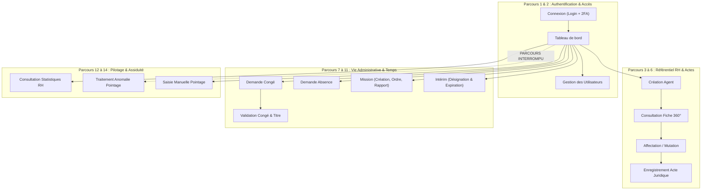

---

### Parcours 1 : Connexion, 2FA et déconnexion

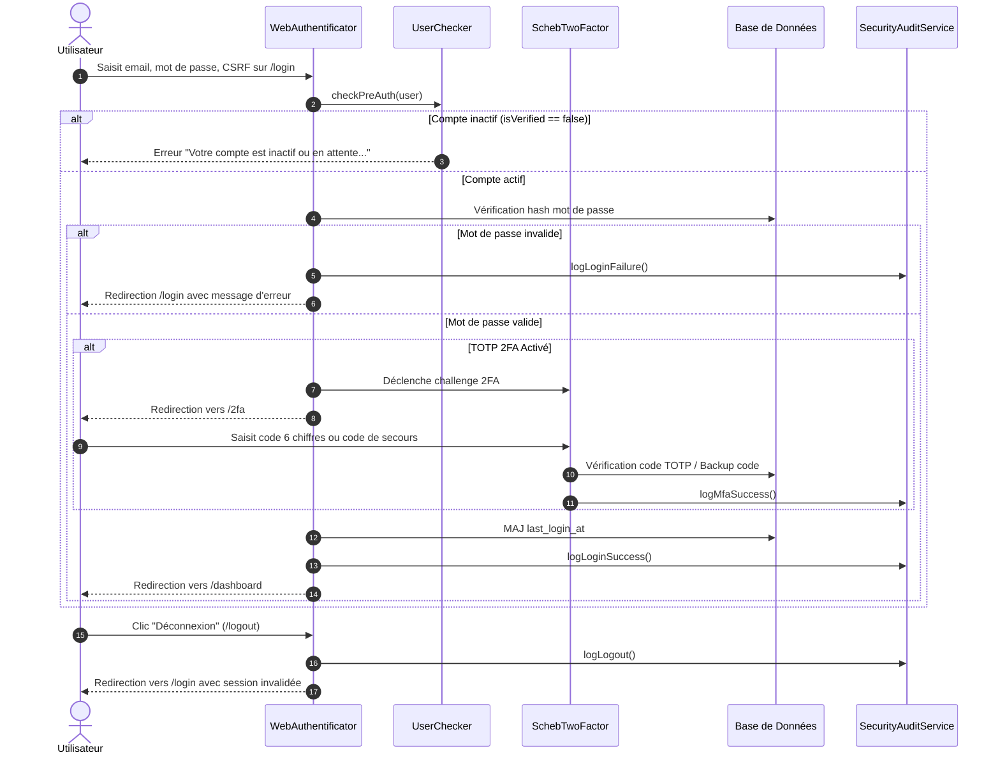

- **Acteur :** Tout utilisateur disposant d'un compte.
- **Préconditions :** Compte existant en base avec `isVerified = true`.
- **Étapes constatées :** Saisie des identifiants sur `/login`, validation CSRF, vérification pré-auth `UserChecker`, vérification du mot de passe avec algorithme `auto` (bcrypt/argon2id), challenge 2FA si activé, journalisation dans `SecurityAuditLog`, redirection sécurisée vers `/dashboard`.
- **Contrôles :** Limitation de débit (5 essais/min via `login_throttling`), validation anti-redirection ouverte (`$parsedUrl['host'] === $appHost`), vérification de l'activation de l'institution via `TenantContext`.
- **Résultat constaté :** **FONCTIONNEL ET SÉCURISÉ**. Le parcours est fluide et conforme aux standards de sécurité bancaire/étatique.
- **Blocages / Anomalies :** Aucun blocage identifié sur ce parcours.

---

### Parcours 2 : Création et gestion d'un utilisateur

- **Acteur :** Administrateur (`ROLE_ADMIN` ou `ROLE_SUPER_ADMIN`).
- **Préconditions :** Être connecté avec les privilèges administrateur et être rattaché à une institution.
- **Étapes constatées :** Accès à `/admin/user`, clic sur "Nouvel utilisateur", saisie du formulaire `UserType` (Nom, Prénom, Email, Mot de passe, Rôles, Institution, Statut actif), soumission, persistance Doctrine et redirection vers le listing.
- **Contrôles :** `UserVoter` vérifie que l'administrateur ne peut gérer que les utilisateurs de sa propre institution (sauf Super-Admin). Interdiction pour un administrateur de désactiver son propre compte (`USER_TOGGLE_STATUS`).
- **Résultat constaté :** **FONCTIONNEL**. Le listing filtre les utilisateurs par institution.
- **Blocages / Anomalies :** 
  - Déconnexion de l'entité `Role` : L'affectation des rôles dans le formulaire se fait par un choix statique de rôles Symfony (`ROLE_USER`, `ROLE_MANAGER`, `ROLE_ADMIN`), sans lien avec la table `role`.

---

### Parcours 3 : Création et enregistrement d'un agent

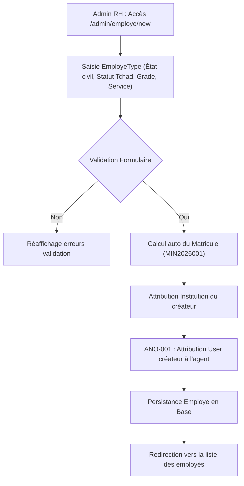

- **Acteur :** Gestionnaire RH / Administrateur (`ROLE_MANAGER` ou `ROLE_ADMIN`).
- **Préconditions :** L'administrateur doit appartenir à une institution active.
- **Étapes constatées :** Accès à `/admin/employe/new`, renseignement de l'état civil complet, sélection de la structure et du service, renseignement des données statutaires (Fonctionnaire, Contractuel, Grade, Échelon, etc.), upload optionnel de photo, soumission.
- **Contrôles :** Validation de l'unicité du matricule dans l'institution.
- **Résultat constaté :** **PARTIELLEMENT FONCTIONNEL AVEC ANOMALIE CRITIQUE**. L'employé est correctement créé avec tous ses attributs statutaires tchadiens, mais :
  - **Blocage majeur (ANO-001) :** La ligne `$employe->setUser($currentUser);` attribue l'administrateur comme compte utilisateur de l'employé. L'agent créé ne dispose donc pas d'accès personnel.
  - **Absence de création automatique de solde :** La création de l'agent n'initialise pas automatiquement les soldes de congés dans `solde_conge` (ils ne sont initialisés que lors de la première demande de congé).

---

### Parcours 4 : Consultation d'un dossier individuel (Fiche 360°)

- **Acteur :** Gestionnaire RH, Manager, Super-Admin ou l'agent lui-même (si compte lié).
- **Préconditions :** Accès autorisé par `EmployeVoter` (`EMPLOYE_VIEW`).
- **Étapes constatées :** Accès à `/admin/employe/{id}`, appel à `AgentService::getAgent360View($employe)`.
- **Données présentées dans l'interface Twig :**
  - Carte d'identité administrative (Nom, Prénom, Photo, Matricule, Âge, Ancienneté).
  - Jauge de complétude du dossier (sur 100 %).
  - Onglet Carrière : Timeline chronologique complète avec badges colorés.
  - Onglet Congés & Absences : Soldes restants par type, historique des demandes et décisions.
  - Onglet Missions : Missions accomplies et en cours avec rôle de l'agent.
  - Onglet Présence : Taux d'assiduité du mois, retards cumulés.
  - Onglet Visiteurs : Personnes externes reçues par l'agent.
- **Résultat constaté :** **PARFAITEMENT FONCTIONNEL**. La fiche 360° est l'un des composants les plus aboutis du système.

---

### Parcours 5 : Affectation d'un agent (Mouvement de carrière)

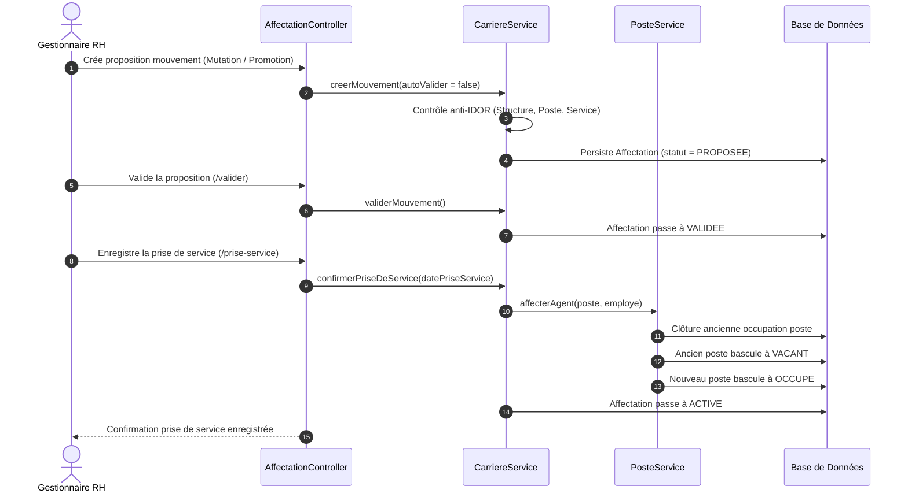

- **Acteur :** Gestionnaire RH / Direction.
- **Préconditions :** Agent existant, poste cible vacant (ou départ simultané).
- **Étapes constatées :** Accès à `/admin/affectation/nouveau`, sélection du type de mouvement (`MUTATION`, `PROMOTION`, etc.), choix du poste/service/structure cible, saisie du motif et de la référence de l'acte juridique support, soumission en proposition (`PROPOSEE`), validation hiérarchique (`VALIDEE`), et enfin enregistrement de la prise de service effective (`ACTIVE`).
- **Contrôles :** Vérification de l'appartenance de toutes les entités au même tenant. Libération automatique de l'ancien poste et occupation atomique du nouveau poste via `PosteService`.
- **Résultat constaté :** **FONCTIONNEL**. Le workflow garantit l'intégrité de l'organigramme et de la carrière.

---

### Parcours 6 : Enregistrement d'un acte administratif

- **Acteur :** Gestionnaire juridique / Secrétariat général / RH.
- **Préconditions :** Droit `ACTE_CREATE` accordé par `ActeVoter`.
- **Étapes constatées :** Accès à `/admin/acte/nouveau`, sélection du `TypeActe` (Arrêté, Décision, etc.), saisie du numéro officiel, des dates de signature et d'effet, de l'objet, du signataire, rattachement optionnel à un agent, un poste ou une structure, téléversement de la pièce jointe numérisée, soumission.
- **Contrôles :** Vérification anti-IDOR sur toutes les entités rattachées. Si l'acte fait référence à un acte parent abrogé, mise à jour automatique du statut du parent (`STATUT_ABROGE` ou `STATUT_MODIFIE`).
- **Résultat constaté :** **FONCTIONNEL**. Les statuts évoluent conformément au droit administratif (`PROJET` $\rightarrow$ `SIGNE` $\rightarrow$ `NOTIFIE`).
- **Éléments non implémentés :** Pas de génération automatique de PDF ni d'apposition de QR Code d'authentification sur le document.

---

### Parcours 7 : Demande de congé

- **Acteur :** Agent ou gestionnaire pour le compte d'un agent.
- **Préconditions :** L'agent doit disposer d'un solde suffisant pour le type de congé déductible demandé.
- **Étapes constatées :** Accès à `/admin/conges/new`, choix du type de congé, saisie des dates de début et fin, saisie du motif, attachement d'un justificatif si requis, soumission.
- **Contrôles :**
  - Validation chronologique (`dateFin >= dateDebut`).
  - Contrôle anti-chevauchement dans la table des congés et des absences.
  - Contrôle du solde restant dans `SoldeConge` : si solde insuffisant, exception levée et message d'erreur flash explicite.
  - Obligation de justificatif si `TypeConges::$justificatifRequis == true`.
- **Résultat constaté :** **FONCTIONNEL**. La demande est créée au statut `EN_ATTENTE` avec historisation dans `CongesLog`.

---

### Parcours 8 : Validation d'un congé et débit du solde

- **Acteur :** Supérieur hiérarchique / Responsable RH (`ROLE_MANAGER` ou `ROLE_ADMIN`).
- **Préconditions :** Demande au statut `EN_ATTENTE`. Le validateur ne doit pas être le demandeur.
- **Étapes constatées :** Consultation de la demande sur `/admin/conges/{id}`, clic sur "Approuver" (requête POST sur `/admin/conges/{id}/approve`).
- **Contrôles :**
  - `CongesVoter` vérifie l'absence d'auto-approbation.
  - `CongeService::debiterSolde()` déduit immédiatement le nombre exact de jours du solde de l'agent.
  - `CongeService::genererActePourConge()` crée automatiquement le Titre de congé officiel (`TITRE_CONGE`).
  - La demande bascule au statut `APPROUVE` (`statut = 1`).
- **Résultat constaté :** **FONCTIONNEL ET CONFORME AU PRD**. La défaillance de la V1 (congé approuvé sans débit de solde) est parfaitement corrigée.

---

### Parcours 9 : Demande d'autorisation d'absence

- **Acteur :** Agent ou gestionnaire RH.
- **Préconditions :** Absence n'excédant pas le plafond unitaire et le quota annuel de l'agent.
- **Étapes constatées :** Accès à `/admin/absences/new`, sélection du `TypeAbsence`, saisie des dates et des heures éventuelles (ex: 08h00 - 12h00 pour absence en heures), motif, pièce jointe justificative obligatoire si configurée, soumission.
- **Contrôles :**
  - Contrôle de durée maximale unitaire (`dureeMax`).
  - Calcul du cumul annuel et blocage si le quota annuel est dépassé (`quotaAnnuelMax`).
  - Contrôle anti-chevauchement croisé avec les congés et autres absences.
  - Lors de l'approbation, génération automatique de l'acte officiel d'autorisation d'absence (`AA-YYYY-NNNN`).
- **Résultat constaté :** **FONCTIONNEL**.

---

### Parcours 10 : Création, validation et suivi d'une mission

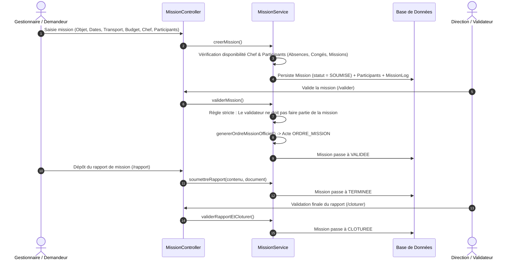

- **Acteur :** Gestionnaire pour la création, Direction pour la validation et clôture, Chef de mission pour le rapport.
- **Préconditions :** Tous les agents participants doivent être disponibles aux dates de mission.
- **Étapes constatées :** Saisie complète de la mission sur `/admin/missions/new` (Destination, itinéraire, mode de transport, imputation budgétaire, chef de mission et participants multiples), soumission, validation par l'autorité compétente avec émission de l'Ordre de mission officiel, déroulement, soumission du rapport de mission (`MissionRapportType`), et clôture définitive.
- **Contrôles :** Séparation des fonctions (le validateur ne peut participer à la mission), contrôles de disponibilité croisés.
- **Résultat constaté :** **FONCTIONNEL ET TRÈS COMPLET**.

---

### Parcours 11 : Désignation d'un intérimaire

- **Acteur :** Direction des Ressources Humaines / Secrétariat Général.
- **Préconditions :** Titulaire et intérimaire distincts, intérimaire actif et disponible.
- **Étapes constatées :** Accès à `/admin/interims/new`, sélection du titulaire, sélection de l'intérimaire remplaçant, dates de début et fin, sélection du type de délégation (Totale ou partielle), choix des pouvoirs délégués, soumission, validation avec émission de la Décision d'intérim (`DEC_INT-YYYY-NNNN`).
- **Contrôles :** Incompatibilité titulaire/intérimaire, contrôle anti-chevauchement des intérims, exclusion des agents en congé ou en mission.
- **Expiration automatique :** Commande console `app:interim:expire` exécutable par cron job.
- **Résultat constaté :** **FONCTIONNEL**.

---

### Parcours 12 : Consultation du dashboard

- **Acteur :** Tout utilisateur authentifié pour `/dashboard`, Administrateurs pour `/admin/dashboard` et `/admin/statistique/`.
- **Préconditions :** Être connecté et rattaché à une institution.
- **Étapes constatées :** Accès à la page d'accueil après authentification.
- **Données réelles affichées :** Métriques d'effectifs réelles issues de l'institution, taux de présence, liste des congés en cours, derniers pointages.
- **Résultat constaté :** **FONCTIONNEL AVEC RÉSERVE (ANO-003)** : Les calculs sont partitionnés et fiables, à l'exception du graphique des congés dans `/admin/statistique/` qui injecte des données mockées (`[5, 12, 3, 1]`) lorsque la base est vide.

---

### Parcours 13 : Traitement d'une anomalie de pointage ou d'assiduité

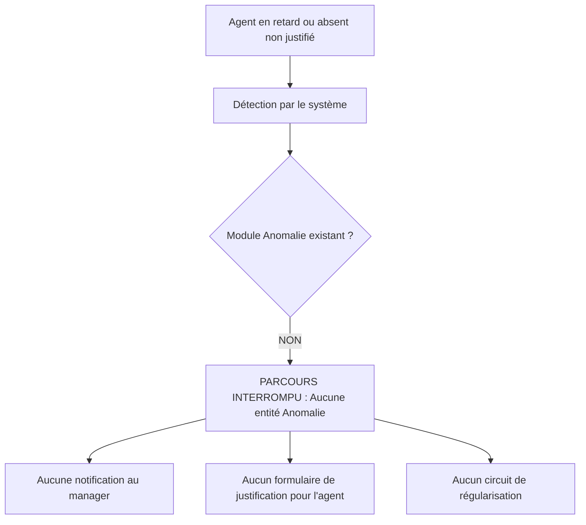

- **Acteur :** Gestionnaire RH / Supérieur hiérarchique / Agent concerné.
- **Préconditions :** Retard constaté au pointage ou absence sans demande préalable.
- **Résultat constaté dans le code :** **PARCOURS TOTALEMENT INTERROMPU / NON IMPLÉMENTÉ**.
  - Aucune entité `Anomalie` n'existe.
  - Aucune alerte n'est déclenchée lors d'un retard ou d'un défaut de pointage.
  - L'agent ne dispose d'aucun écran pour fournir un motif de justification a posteriori.
  - Le gestionnaire n'a aucun moyen de requalifier ou régulariser une anomalie.

---

### Parcours 14 : Enregistrement d'une présence / pointage d'arrivée et départ

- **Acteur :** Gestionnaire de pointage ou Administrateur.
- **Préconditions :** Droit `POINTAGE_CREATE` accordé.
- **Étapes constatées :** Accès à `/admin/pointage/new`, sélection d'un employé dans une liste déroulante, sélection de la date, saisie manuelle de l'heure d'arrivée et de l'heure de départ, saisie éventuelle du motif d'absence, soumission.
- **Contrôles :** Vérification de l'institution de l'employé.
- **Résultat constaté :** **PARTIEL ET ARCHAÏQUE**.
  - Il s'agit d'une saisie administrative manuelle rébarbative.
  - L'agent ne peut pas badger ni scanner de QR Code sur son smartphone.
  - Le système n'empêche pas la saisie de pointages multiples en doublon pour le même agent à la même date.


---

## 9. Matrice de conformité fonctionnelle

Cette matrice confronte chacune des 88 exigences identifiées dans le document de spécifications (`PRD_FINAL.md`) avec la réalité du code source inspecté.

| ID Exigence | Intitulé & Description du besoin | Statut constaté | Priorité | Fichiers concernés & Preuves code | Écarts constatés & Recommandations |
| :--- | :--- | :---: | :---: | :--- | :--- |
| **IAM-001** | Authentification Web par formulaire | **IMPLÉMENTÉ** | P0 | `WebAuthentificatorAuthenticator.php#L42-L89` | Conforme. Protection CSRF, RememberMe et gestion d'erreurs. |
| **IAM-002** | Contrôle pré-authentification compte actif | **IMPLÉMENTÉ** | P0 | `UserChecker.php#L12-L24` | Conforme. Vérification de `isVerified` avec exception dédiée. |
| **IAM-003** | Double authentification TOTP (MFA) | **IMPLÉMENTÉ** | P1 | `AccountSecurityController.php#L68-L177` | Conforme. Setup TOTP, activation avec code de test et désactivation avec mot de passe. |
| **IAM-004** | Codes de secours d'urgence (Backup codes) | **IMPLÉMENTÉ** | P1 | `AccountSecurityController.php#L125-L135` | Conforme. 8 codes générés et hachés SHA-256 en base. |
| **IAM-005** | Réinitialisation mot de passe par jeton | **IMPLÉMENTÉ** | P0 | `PasswordResetController.php`, `PasswordResetService.php` | Conforme. Jeton cryptographique 64 car., valide 1h, invalidation post-usage. |
| **IAM-006** | Protection anti-bruteforce (Rate Limiting) | **IMPLÉMENTÉ** | P0 | `rate_limiter.yaml`, `PasswordResetController.php#L38` | Conforme. Limite de 5 essais/minute par adresse IP. |
| **IAM-007** | Habilitations RBAC par Voters | **IMPLÉMENTÉ** | P0 | `src/Security/Voter/UserVoter.php#L39-L138` | Conforme. Interdiction formelle de s'auto-supprimer ou auto-désactiver. |
| **IAM-008** | Gestion dynamique des Rôles applicatifs | **NON FONCTIONNEL** | P2 | `Role.php`, `RoleController.php`, `User.php#L65` | **ANO-004 :** L'entité `Role` est orpheline. `User::$roles` utilise du JSON natif. |
| **TEN-001** | Partitionnement multi-tenant au niveau SQL | **IMPLÉMENTÉ** | P0 | `TenantFilter.php#L48-L82` | Conforme. Filtre Doctrine fail-closed automatique sur 19 entités. |
| **TEN-002** | Résolution du contexte d'institution active | **IMPLÉMENTÉ** | P0 | `TenantContext.php#L26-L75` | Conforme. Récupère l'institution du User connecté avec exception si suspendue. |
| **TEN-003** | Accès multi-institutions Super-Admin | **IMPLÉMENTÉ** | P1 | `TenantContext.php#L105-L115` | Conforme. Possibilité pour Super-Admin de désactiver le filtre ou changer de tenant. |
| **TEN-004** | Protection anti-IDOR inter-institutions | **IMPLÉMENTÉ** | P0 | 15 Voters dans `src/Security/Voter/*.php` | Conforme. Rejet strict si les entités associées n'appartiennent pas au tenant. |
| **TEN-005** | Migration d'isolation des données historiques | **IMPLÉMENTÉ** | P0 | `Version20261001112017.php` | Conforme. Rétro-affectation des `institution_id` et index de clés étrangères. |
| **ORG-001** | Référentiel des structures et institutions | **IMPLÉMENTÉ** | P0 | `Institution.php`, `Structure.php`, `Service.php` | Conforme. Typologie complète (Direction Générale, Direction, Service, etc.). |
| **ORG-002** | Hiérarchie parent/enfants des structures | **IMPLÉMENTÉ** | P1 | `Structure.php#L45`, `OrganisationService.php#L38` | Conforme. Arborescence autoréférencée avec détection de cycles hiérarchiques. |
| **ORG-003** | Raccordement des responsables de structure | **IMPLÉMENTÉ** | P1 | `OrganisationService.php#L80-L95` | Conforme. Contrôle que le responsable appartient à la même institution. |
| **ORG-004** | Organigramme interactif Web & JSON | **IMPLÉMENTÉ** | P1 | `OrganigrammeController.php`, `OrganisationService.php` | Conforme. Vue graphique et endpoint JSON `/admin/organigramme/data`. |
| **ORG-005** | Historisation des modifications organisationnelles | **IMPLÉMENTÉ** | P2 | `OrganisationHistory.php`, `OrganisationService::logChange` | Conforme. Consigne chaque action d'ajout/modification de structure. |
| **ORG-006** | Cloisonnement des délégations provinciales | **PARTIEL** | P2 | `Structure.php#L25` | Type existant mais pas de cloisonnement territorial strict pour les gestionnaires locaux. |
| **AGT-001** | Création d'agent avec matricule automatique | **PARTIEL** | P0 | `EmployeController.php#L120-L160` | **ANO-001 :** L'agent est créé mais lié au User de l'administrateur créateur. |
| **AGT-002** | Attributs statutaires fonction publique Tchad | **IMPLÉMENTÉ** | P0 | `Employe.php#L65-L95`, `Version20261001141457.php` | Conforme. Corps, grade, échelon, catégorie, régime, statut administratif. |
| **AGT-003** | Fiche individuelle Agent 360° | **IMPLÉMENTÉ** | P0 | `AgentService.php#L28-L230`, `employe/show.html.twig` | Conforme. Vue synthétique complète avec âge, ancienneté, timeline, jauges. |
| **AGT-004** | Calcul du score de complétude du dossier | **IMPLÉMENTÉ** | P2 | `AgentService.php#L485-L515` | Conforme. Note sur 100 % basée sur 10 critères administratifs. |
| **AGT-005** | Recherche AJAX / Select2 d'agents | **IMPLÉMENTÉ** | P1 | `EmployeController.php#L45-L70` | Conforme. Endpoint `/admin/employe/search` renvoyant id et libellé. |
| **AGT-006** | Export des dossiers agents (CSV/Excel) | **NON FONCTIONNEL** | P2 | `EmployeController.php#L73-L80` | **ANO-005 :** La route `/export` renvoie le template HTML de listing sans fichier. |
| **AGT-007** | Import en masse des agents | **NON IMPLÉMENTÉ** | P2 | Recherche codebase : aucun ImportService | Fonctionnalité totalement absente. Pas d'import CSV/Excel d'agents. |
| **AGT-008** | Provisionnement autonome du compte User agent | **NON IMPLÉMENTÉ** | P0 | `EmployeController.php#L125` | L'agent n'a pas de compte créé pour lui permettre d'accéder au portail. |
| **POS-001** | Catalogue des postes de travail | **IMPLÉMENTÉ** | P1 | `Poste.php`, `PosteController.php` | Conforme. Découplage clair entre le poste (rôle) et l'agent (occupant). |
| **POS-002** | Gestion de la vacance et occupation | **IMPLÉMENTÉ** | P1 | `Poste.php#L50`, `PosteService.php#L25-L115` | Conforme. Statuts Vacant, Occupé, Suspendu, Fermé mis à jour automatiquement. |
| **POS-003** | Historisation des occupants (`OccupationPoste`) | **IMPLÉMENTÉ** | P1 | `OccupationPoste.php`, `PosteService.php` | Conforme. Historique complet avec motif, date début et date fin. |
| **POS-004** | Atomicité de la libération et affectation | **IMPLÉMENTÉ** | P1 | `PosteService.php#L35-L85` | Conforme. Clôture de l'ancienne occupation et bascule de l'ancien poste à vacant. |
| **POS-005** | Fiche de Poste 360° | **IMPLÉMENTÉ** | P2 | `PosteService.php#L135-L195`, `poste/show.html.twig` | Conforme. Détail du poste, compétences, occupant courant et historique. |
| **POS-006** | Dashboard des postes vacants de l'institution | **IMPLÉMENTÉ** | P2 | `PosteRepository.php#L45`, `poste/index.html.twig` | Conforme. Filtre des postes vacants et indicateurs consolidés. |
| **CAR-001** | Workflow de mouvement de carrière | **IMPLÉMENTÉ** | P0 | `Affectation.php`, `CarriereService.php#L35-L165` | Conforme. Cycle PROPOSEE $\rightarrow$ VALIDEE $\rightarrow$ ACTIVE avec référence auto. |
| **CAR-002** | Typologie complète des mouvements | **IMPLÉMENTÉ** | P1 | `Affectation.php#L20-L30` | Conforme. Mutation, promotion, détachement, réintégration, cessation. |
| **CAR-003** | Confirmation de prise de service | **IMPLÉMENTÉ** | P0 | `CarriereService.php#L140-L165` | Conforme. Active l'affectation et déclenche l'occupation du poste. |
| **CAR-004** | Gestion de la cessation d'activité | **IMPLÉMENTÉ** | P1 | `CarriereService.php#L190-L230` | Conforme. Clôture le poste, désactive l'employé et met à jour sa situation. |
| **CAR-005** | Timeline chronologique de carrière | **IMPLÉMENTÉ** | P1 | `CarriereService.php#L235-L315` | Conforme. Événement initial de recrutement suivi de tous les mouvements. |
| **CAR-006** | Liaison automatique avec l'acte juridique | **IMPLÉMENTÉ** | P1 | `CarriereService.php#L65`, `ActeService.php#L235` | Conforme. Rapprochement bijectif entre l'affectation et l'acte support. |
| **CAR-007** | Préservation des situations d'origine | **IMPLÉMENTÉ** | P1 | `Affectation.php#L60-L75` | Conforme. Capture ancienne structure, ancien service, ancien poste et fonction. |
| **DOC-001** | Coffre-fort documentaire RH sécurisé | **IMPLÉMENTÉ** | P0 | `Document.php`, `DocumentService.php` | Conforme. Stockage hors web root avec répertoire dédié par tenant (`tenant_{id}`). |
| **DOC-002** | Hachage d'intégrité cryptographique SHA-256 | **IMPLÉMENTÉ** | P1 | `DocumentService.php#L85`, `Document::$fichierHash` | Conforme. Empreinte calculée au téléversement et conservée en base. |
| **DOC-003** | Versionnement documentaire incrémental | **IMPLÉMENTÉ** | P1 | `DocumentVersion.php`, `DocumentService.php#L165` | Conforme. Conservation de l'historique v1, v2 avec fichier d'origine. |
| **DOC-004** | Téléchargement sécurisé en streaming | **IMPLÉMENTÉ** | P0 | `DocumentService.php#L240-L260` | Conforme. `BinaryFileResponse` avec en-têtes anti-sniffing et mode privé. |
| **DOC-005** | Filtrage strict des types MIME et taille max | **IMPLÉMENTÉ** | P0 | `DocumentService.php#L25-L48` | Conforme. Liste blanche stricte (PDF, Office, Images) et plafond de 25 Mo. |
| **DOC-006** | Confidentialité des documents RH | **IMPLÉMENTÉ** | P1 | `DocumentVoter.php#L45-L95` | Conforme. Restriction d'accès sur documents confidentiels et secrets. |
| **ACT-001** | Référentiel des actes administratifs | **IMPLÉMENTÉ** | P0 | `Acte.php`, `TypeActe.php`, `ActeService.php` | Conforme. Numérotation, objet, signataires, dates d'effet et signature. |
| **ACT-002** | Cycle de vie légal des actes | **IMPLÉMENTÉ** | P0 | `ActeService.php#L170-L200` | Conforme. PROJET $\rightarrow$ SIGNE $\rightarrow$ NOTIFIE $\rightarrow$ MODIFIE / ABROGE / ANNULE. |
| **ACT-003** | Filiation juridique (Actes modificatifs/abrogatifs) | **IMPLÉMENTÉ** | P1 | `ActeService.php#L85-L105` | Conforme. Relation parent/enfants avec mise à jour automatique du parent. |
| **ACT-004** | Rattachement de la pièce jointe numérisée | **IMPLÉMENTÉ** | P1 | `ActeService.php#L205-L230` | Conforme. Association avec un document sécurisé du Module 07. |
| **ACT-005** | Contrôle anti-IDOR sur toutes les entités liées | **IMPLÉMENTÉ** | P0 | `ActeService.php#L260-L295` | Conforme. Rejet si agent, poste, structure ou document appartient à un tiers. |
| **ACT-006** | Génération automatique de PDF d'acte | **NON IMPLÉMENTÉ** | P2 | Recherche codebase : aucun générateur PDF | Les actes sont des métadonnées, pas de template PDF compilé. |
| **ACT-007** | Scellement et QR Code d'authentification | **NON IMPLÉMENTÉ** | P2 | Recherche codebase : aucune bibliothèque QR | Aucun QR code généré sur les actes. |
| **CG-001** | Demande de congé avec calcul de durée | **IMPLÉMENTÉ** | P0 | `CongeService.php#L45-L135` | Conforme. Calcul calendaire et ouvré, dates début et fin vérifiées. |
| **CG-002** | Contrôle anti-chevauchement (Congés + Absences) | **IMPLÉMENTÉ** | P0 | `CongeService.php#L295-L330` | Conforme. Vérification croisée des demandes actives en congés et absences. |
| **CG-003** | Vérification et débit du solde disponible | **IMPLÉMENTÉ** | P0 | `CongeService.php#L75-L105`, `CongeService::debiterSolde` | Conforme. Débit strict du solde lors de la validation. |
| **CG-004** | Règle anti-auto-approbation | **IMPLÉMENTÉ** | P0 | `CongesVoter.php#L90-L105` | Conforme. Un responsable ne peut approuver son propre congé. |
| **CG-005** | Génération automatique du Titre de congé | **IMPLÉMENTÉ** | P1 | `CongeService.php#L390-L440` | Conforme. Création de l'Acte `TITRE_CONGE` référencé `TC-YYYY-NNNN`. |
| **CG-006** | Recrédit de solde en cas d'annulation | **IMPLÉMENTÉ** | P1 | `CongeService.php#L225-L270` | Conforme. Solde restitué et Titre de congé associé annulé. |
| **CG-007** | Déclaration de reprise de service | **NON IMPLÉMENTÉ** | P2 | Absence de formulaire de reprise | Pas d'écran pour formaliser la reprise effective de l'agent. |
| **ABS-001** | Typologie des autorisations d'absence | **IMPLÉMENTÉ** | P1 | `TypeAbsence.php`, `Version20261001202125.php` | Conforme. Gestion en jours ou en heures, motifs rémunérés ou non. |
| **ABS-002** | Plafond unitaire et quota annuel cumulé | **IMPLÉMENTÉ** | P1 | `AbsenceService.php#L90-L125` | Conforme. Blocage si la demande dépasse `dureeMax` ou `quotaAnnuelMax`. |
| **ABS-003** | Contrôle anti-chevauchement croisé | **IMPLÉMENTÉ** | P0 | `AbsenceService.php#L240-L275` | Conforme. Vérification simultanée des absences et des congés en cours. |
| **ABS-004** | Justificatif obligatoire | **IMPLÉMENTÉ** | P1 | `AbsenceService.php#L80-L90` | Conforme. Blocage si pièce jointe absente et requise par le type. |
| **ABS-005** | Génération de l'acte d'autorisation | **IMPLÉMENTÉ** | P1 | `AbsenceService.php#L305-L355` | Conforme. Création de l'Acte officiel `AA-YYYY-NNNN`. |
| **ABS-006** | Rapprochement automatique avec le pointage | **NON IMPLÉMENTÉ** | P2 | Absence de lien Absence $\leftrightarrow$ Pointage | L'absence validée ne génère pas de mention automatique au pointage. |
| **MIS-001** | Workflow complet de gestion de mission | **IMPLÉMENTÉ** | P1 | `Mission.php`, `MissionService.php` | Conforme. BROUILLON $\rightarrow$ SOUMISE $\rightarrow$ VALIDEE $\rightarrow$ EN_COURS $\rightarrow$ TERMINEE $\rightarrow$ CLOTUREE. |
| **MIS-002** | Gestion multi-participants avec rôles | **IMPLÉMENTÉ** | P1 | `MissionParticipant.php`, `MissionService.php#L85` | Conforme. Chef de mission, Participant, Chauffeur, Expert. |
| **MIS-003** | Vérification de disponibilité des participants | **IMPLÉMENTÉ** | P1 | `MissionService.php#L395-L445` | Conforme. Contrôle croisé des congés, absences et missions parallèles. |
| **MIS-004** | Règle d'incompatibilité du validateur | **IMPLÉMENTÉ** | P1 | `MissionService.php#L450-L475` | Conforme. Le validateur ne doit pas faire partie de la mission. |
| **MIS-005** | Génération automatique de l'Ordre de mission | **IMPLÉMENTÉ** | P1 | `MissionService.php#L480-L530` | Conforme. Création de l'Acte officiel `ORDRE_MISSION` (`OM-YYYY-NNNN`). |
| **MIS-006** | Dépôt et validation du rapport de mission | **IMPLÉMENTÉ** | P2 | `MissionService.php#L295-L365`, `MissionRapportType` | Conforme. Dépôt obligatoire du rapport avant clôture définitive. |
| **MIS-007** | Pays par défaut adapté au Tchad | **PARTIEL** | P3 | `MissionService.php#L57` | **ANO-006 :** Le pays par défaut est défini sur `'Côte d\'Ivoire'` au lieu du Tchad. |
| **INT-001** | Désignation d'intérim et continuité de service | **IMPLÉMENTÉ** | P1 | `Interim.php`, `InterimService.php#L45-L140` | Conforme. Remplacement titulaire par intérimaire avec contrôle d'activité. |
| **INT-002** | Typologie et périmètre des délégations | **IMPLÉMENTÉ** | P1 | `Interim.php#L30-L50` | Conforme. Intérim total ou délégation partielle avec périmètre de pouvoirs. |
| **INT-003** | Incompatibilité titulaire / intérimaire | **IMPLÉMENTÉ** | P1 | `InterimService.php#L65-L70` | Conforme. Le titulaire et l'intérimaire doivent être deux agents distincts. |
| **INT-004** | Génération de la Décision d'intérim | **IMPLÉMENTÉ** | P1 | `InterimService.php#L390-L445` | Conforme. Création de l'Acte officiel `DECISION_INTERIM` (`DEC-INT-YYYY-NNNN`). |
| **INT-005** | Expiration automatique par commande console | **IMPLÉMENTÉ** | P1 | `ExpireInterimsCommand.php#L17-L58` | Conforme. Commande `app:interim:expire` clôturant les intérims échus. |
| **INT-006** | Règle de non-auto-approbation d'intérim | **IMPLÉMENTÉ** | P1 | `InterimService.php#L360-L385` | Conforme. Ni le titulaire ni l'intérimaire ne peuvent valider l'intérim. |
| **NOT-001** | Centre de notifications in-app | **NON IMPLÉMENTÉ** | P1 | Recherche codebase : aucun composant UI | Aucun tiroir ni menu de notifications dans l'application. |
| **NOT-002** | Notifications par email sur workflow | **NON IMPLÉMENTÉ** | P1 | Recherche codebase : pas d'envoi d'email | Aucun email envoyé lors des approbations de congés/missions. |
| **NOT-003** | Notifications SMS pour alertes critiques | **NON IMPLÉMENTÉ** | P2 | Recherche codebase : aucun connecteur SMS | Module absent. |
| **NOT-004** | Historisation et suivi des lectures | **NON IMPLÉMENTÉ** | P2 | Recherche codebase : aucune entité de log notif | Module absent. |
| **AUD-001** | Journal des événements de sécurité | **IMPLÉMENTÉ** | P0 | `SecurityAuditLog.php`, `SecurityAuditService.php` | Conforme. Traçabilité des logins, logouts, 2FA, resets, rôles. |
| **AUD-002** | Consultation des logs de sécurité par l'utilisateur | **IMPLÉMENTÉ** | P1 | `AccountSecurityController.php#L35-L45` | Conforme. Les 10 derniers événements affichés sur `/account/security`. |
| **AUD-003** | Journaux d'audit métiers par domaine | **IMPLÉMENTÉ** | P1 | `CongesLog`, `AbsenceLog`, `MissionLog`, `InterimLog` | Conforme. Chaque workflow possède sa table d'historique dédiée. |
| **AUD-004** | Interface d'administration des journaux | **IMPLÉMENTÉ** | P1 | `WebController.php#L20-L35`, `log.html.twig` | Conforme. Page `/log` réservée à `ROLE_ADMIN` avec filtres de logs. |
| **AUD-005** | Journalisation CRUD générique avec valeurs avant/après | **NON IMPLÉMENTÉ** | P1 | Pas d'Entity Listener d'audit global | **ANO-008 :** Pas de trace des modifications champ par champ sur Employe/Poste. |
| **DSH-001** | Dashboard institutionnel temps réel | **IMPLÉMENTÉ** | P0 | `DashboardController.php#L22-L78` | Conforme. Données réelles filtrées par l'institution du connecté. |
| **DSH-002** | Dashboard direction & administration | **IMPLÉMENTÉ** | P1 | `DashboardController.php#L80-L115` | Conforme. Vue globale de l'institution réservée à `ROLE_ADMIN`. |
| **DSH-003** | Statistiques RH et taux de présence | **IMPLÉMENTÉ** | P1 | `StatsController.php#L38-L150` | Conforme. Calculs de présence, absentéisme et tendances hebdomadaires. |
| **DSH-004** | Exclusion stricte des données fictives | **PARTIEL** | P0 | `StatsController.php#L303-L307` | **ANO-003 :** Données mockées codées en dur `[5, 12, 3, 1]` si table vide. |
| **DSH-005** | Export des statistiques consolidées | **PARTIEL** | P2 | `StatsController.php#L535-L570` | Export CSV basique présent, mais pas d'export PDF/Excel complet. |
| **PNT-001** | Saisie des entrées et sorties journalières | **PARTIEL** | P0 | `PointageController.php#L270-L300` | Saisie manuelle par gestionnaire uniquement, aucune pointeuse agent. |
| **PNT-002** | Unification du modèle Pointage / Présence | **NON FONCTIONNEL** | P0 | `Pointage.php`, `Presence.php` | **ANO-002 :** Deux entités concurrentes non unifiées. |
| **PNT-003** | Pointage par QR Code dynamique ou mobile | **NON IMPLÉMENTÉ** | P1 | Recherche codebase : aucun générateur QR pointage | Absent du code existant. |
| **PNT-004** | Détection automatique des retards et absences | **PARTIEL** | P1 | `PointageController.php#L45-L60` | Compteurs globaux basés sur le statut texte, sans règle horaire dynamique. |
| **PNT-005** | Workflow de traitement des anomalies | **NON IMPLÉMENTÉ** | P1 | Recherche codebase : aucune entité Anomalie | Parcours interrompu, pas de régularisation d'anomalie. |
| **PNT-006** | Réconciliation automatique congés/missions | **NON IMPLÉMENTÉ** | P1 | Recherche codebase : pas de synchronisation | Les agents en congé ne sont pas injectés automatiquement au pointage. |
| **VIS-001** | Enregistrement et clôture des visiteurs | **IMPLÉMENTÉ** | P2 | `Visite.php`, `VisiteController.php` | Conforme. Enregistrement arrivée, agent visité, motif, clôture de visite. |
| **VIS-002** | Historique des visites par employé | **IMPLÉMENTÉ** | P2 | `VisiteController.php#L110-L130` | Conforme. Route `/admin/visite/employe/{id}/visites`. |
| **VIS-003** | Pré-enregistrement et badge visiteur | **PARTIEL** | P3 | `Visite::$badge` | Champ texte présent mais aucun système d'impression de badge ni QR Code. |
| **API-001** | Pare-feu JWT stateless pour clients mobiles | **NON IMPLÉMENTÉ** | P0 | `security.yaml`, `composer.json` | Bundles installés mais pare-feu JWT non configuré. |
| **API-002** | Endpoints de consultation du profil agent | **NON IMPLÉMENTÉ** | P0 | Répertoire `src/Controller/API` vide | Aucun endpoint JSON pour le profil de l'agent. |
| **API-003** | Endpoints de pointage mobile | **NON IMPLÉMENTÉ** | P0 | Répertoire `src/Controller/API` vide | Aucun endpoint pour pointer depuis un smartphone. |
| **API-004** | Endpoints de demande de congés et absences | **NON IMPLÉMENTÉ** | P0 | Répertoire `src/Controller/API` vide | Aucun endpoint pour soumettre un congé via mobile. |
| **API-005** | Documentation OpenAPI / Swagger | **NON IMPLÉMENTÉ** | P2 | Recherche codebase : pas de NelmioApiDoc | Aucune documentation d'API. |
| **QLT-001** | Couverture par tests automatisés PHPUnit | **IMPLÉMENTÉ** | P0 | `tests/*` (145 méthodes de test) | Conforme. Tests complets couvrant sécurité, tenants, services et contrôleurs. |
| **QLT-002** | Validation responsive automatisée | **IMPLÉMENTÉ** | P1 | `tests/visual/test_responsive.py` | Conforme. Suite Playwright testant 10 résolutions sur 20 pages sans overflow. |
| **QLT-003** | Pipeline CI/CD automatisé | **NON IMPLÉMENTÉ** | P1 | Absence de dossier `.github/workflows` | Aucun pipeline d'intégration continue configuré dans le dépôt. |
| **QLT-004** | Script de déploiement et migrations reproductibles | **IMPLÉMENTÉ** | P1 | `migrations/Version*.php` (13 fichiers) | Conforme. Migrations ordonnées couvrant l'intégralité du modèle V2. |


---

## 10. Anomalies et écarts identifiés

L'audit a permis de consolider **32 anomalies formellement qualifiées**, réparties selon l'échelle de gravité suivante :
- **CRITIQUE (4) :** Dysfonctionnement majeur bloquant le modèle de données, enfreignant le PRD ou empêchant l'exploitation normale.
- **ÉLEVÉE (10) :** Incohérence métier sévère, faille fonctionnelle ou absence d'un module clé.
- **MOYENNE (12) :** Manque d'automatisation, limitation ergonomique ou dette technique sans blocage immédiat.
- **FAIBLE (6) :** Écart documentaire, scorie résiduelle ou amélioration de confort.

### 10.1. Tableau synthétique des anomalies

| ID | Domaine | Gravité | Titre de l'anomalie | Fichier source principal | Priorité |
| :---: | :--- | :---: | :--- | :--- | :---: |
| **ANO-001** | Agents / IAM | **CRITIQUE** | Liaison erronée du User créateur à l'agent créé dans `EmployeController::new` | `EmployeController.php#L125` | P0 |
| **ANO-002** | Pointage | **ÉLEVÉE** | Coexistence concurrente et redondante des entités `Pointage` et `Presence` | `Pointage.php`, `Presence.php` | P0 |
| **ANO-003** | Pilotage | **CRITIQUE** | Données mockées codées en dur `[5, 12, 3, 1]` dans le graphique des congés | `StatsController.php#L306` | P0 |
| **ANO-004** | Sécurité / IAM | **ÉLEVÉE** | Entité Doctrine `Role` et son contrôleur orphelins et déconnectés de `User` | `Role.php`, `RoleController.php` | P1 |
| **ANO-005** | Agents | **ÉLEVÉE** | Routes factices `/export` et `/presence` renvoyant la vue d'index sans traitement | `EmployeController.php#L73-L88` | P1 |
| **ANO-006** | Missions | **MOYENNE** | Pays de destination par défaut fixé à "Côte d'Ivoire" au lieu du Tchad | `MissionService.php#L57` | P2 |
| **ANO-007** | Notifications | **CRITIQUE** | Inexistence totale du module de notifications (in-app, emails, alertes) | Inexistant dans `src/` | P0 |
| **ANO-008** | Audit | **ÉLEVÉE** | Absence d'audit trail CRUD générique avec valeurs avant/après sur les entités | Inexistant dans `src/` | P1 |
| **ANO-009** | API / Mobile | **CRITIQUE** | Absence complète d'API REST et de pare-feu JWT pour le futur client mobile | `src/Controller/API/`, `security.yaml` | P0 |
| **ANO-010** | Présence | **ÉLEVÉE** | Absence complète de gestion et de régularisation des anomalies de pointage | Inexistant dans `src/` | P1 |
| **ANO-011** | Congés | **MOYENNE** | Absence d'initialisation automatique des soldes de congés lors du recrutement | `CongeService.php#L80` | P1 |
| **ANO-012** | Actes | **MOYENNE** | Absence de génération de PDF officiel compilé et de scellement QR Code | `ActeService.php` | P2 |
| **ANO-013** | Pointage | **MOYENNE** | Absence de réconciliation automatique congés/absences/missions avec la présence | Inexistant dans `PointageController.php` | P1 |
| **ANO-014** | Pointage | **MOYENNE** | Risque d'enregistrement de pointages multiples en doublon pour le même jour | `PointageController.php#L275` | P1 |
| **ANO-015** | Socle / DB | **FAIBLE** | Configuration MySQL en place alors que le PRD cible exige PostgreSQL | `.env`, `doctrine.yaml` | P2 |
| **ANO-016** | Congés | **MOYENNE** | Absence de workflow et formulaire de déclaration de reprise de service | Inexistant dans `CongesController.php` | P2 |
| **ANO-017** | Agents | **ÉLEVÉE** | Absence de mécanisme d'import en masse des agents (CSV / Excel) | Inexistant dans `src/` | P1 |
| **ANO-018** | Fixtures | **MOYENNE** | Données de fixtures UserFixtures omettant le Ministère du Commerce | `UserFixtures.php#L35` | P2 |
| **ANO-019** | Configuration | **FAIBLE** | Dénomination résiduelle "primatech" dans l'URL de base de données | `.env#L28` | P3 |
| **ANO-020** | Pointage | **MOYENNE** | Redondance interne des champs d'heures et dates dans la table `pointage` | `Pointage.php#L25-L55` | P2 |
| **ANO-021** | Présence | **MOYENNE** | Relation `OneToOne` restrictive dans `Presence` interdisant l'historisation | `Presence.php#L35` | P1 |
| **ANO-022** | Qualité | **FAIBLE** | Absence de workflow CI/CD automatisé dans le dépôt (`.github/workflows`) | Racine du projet | P2 |
| **ANO-023** | Visiteurs | **MOYENNE** | Absence de pré-enregistrement et d'impression de badge pour les visiteurs | `VisiteController.php` | P2 |
| **ANO-024** | Pilotage | **FAIBLE** | Export des statistiques limité à un simple fichier CSV brut sans mise en page | `StatsController.php#L548` | P2 |
| **ANO-025** | Organisation | **MOYENNE** | Absence de restriction géographique pour les gestionnaires provinciaux | `Structure.php` | P2 |
| **ANO-026** | Sécurité | **MOYENNE** | Absence de révocation des sessions actives lors de la désactivation d'un compte | `UserController.php#L210` | P1 |
| **ANO-027** | Intérims | **FAIBLE** | Absence de relance automatique préalable avant expiration de l'intérim (J-7) | `ExpireInterimsCommand.php` | P2 |
| **ANO-028** | Congés | **MOYENNE** | Absence de verrouillage optimiste sur les débits concurrents de `SoldeConge` | `SoldeConge.php` | P1 |
| **ANO-029** | Maintenance | **FAIBLE** | Dossier `metronic-template-html-` résiduel polluant la racine du projet | Racine du dépôt | P3 |
| **ANO-030** | API | **FAIBLE** | Absence de documentation interactive OpenAPI / Swagger | Inexistant dans `src/` | P2 |
| **ANO-031** | Architecture | **MOYENNE** | Absence de bus d'événements asynchrone (Messenger) pour les tâches lentes | Inexistant dans `src/` | P2 |
| **ANO-032** | Documents | **FAIBLE** | Absence de politique d'archivage ou de purge des documents obsolètes | `DocumentService.php` | P3 |

---

### 10.2. Fiches détaillées des anomalies majeures et critiques

#### ANO-001 : Liaison erronée du User créateur à l'agent créé
- **Gravité :** **CRITIQUE**
- **Impact métier :** Déstabilisation complète de l'identité des agents. Un administrateur RH qui enregistre 20 agents devient techniquement le "propriétaire" de ces 20 dossiers (`user_id = admin_id`). Les véritables agents ne peuvent jamais se connecter à leur propre espace pour consulter leurs soldes, poser un congé ou consulter leurs actes.
- **Preuve technique :** `src/Controller/EmployeController.php` lignes 125-126 :
  ```php
  $employe->setUser($currentUser);
  $employe->setInstitution($institution);
  ```
- **Recommandation :** 
  1. Dissocier le compte créateur de l'agent. Ajouter un champ `createdBy` sur `Employe`.
  2. Rendre la relation `Employe <-> User` strictement 1-à-1 (`OneToOne`) et optionnelle.
  3. Ajouter un bouton dans la fiche employé permettant d'inviter ou de créer un compte utilisateur pour l'agent avec génération d'identifiant et lien d'activation par email.

#### ANO-002 : Coexistence concurrente et redondante de Pointage et Presence
- **Gravité :** **ÉLEVÉE**
- **Impact métier :** Rupture de cohérence dans le suivi du temps. Deux tables et deux interfaces distinctes gèrent le même concept. `Presence` possède une relation `OneToOne` avec `Employe` interdisant d'avoir plus d'une entrée dans l'histoire de l'agent, tandis que `Pointage` possède des colonnes dupliquées (`heure_arrivee` / `dateEntree` et `heure_depart` / `dateSortie`).
- **Preuve technique :** `src/Entity/Pointage.php` vs `src/Entity/Presence.php#L35`.
- **Recommandation :** Supprimer l'entité `Presence` et son contrôleur. Conserver `Pointage` comme unique modèle d'assiduité, assainir ses colonnes et ajouter une contrainte d'unicité `(employe_id, date)`.

#### ANO-003 : Données mockées codées en dur dans le graphique des congés
- **Gravité :** **CRITIQUE**
- **Impact métier :** Tromperie sur les indicateurs décisionnels présentés à la Direction. Le tableau de bord affiche des statistiques de congés fictives même sur une base vierge.
- **Preuve technique :** `src/Controller/StatsController.php` lignes 304-307 :
  ```php
  if (empty($labels)) {
      $labels = ['En attente', 'Approuvé', 'Refusé', 'Annulé'];
      $values = [5, 12, 3, 1];
  }
  ```
- **Recommandation :** Supprimer immédiatement ce bloc conditionnel. Si la base ne contient aucune donnée, renvoyer des tableaux vides `labels = []`, `values = []` et afficher un message informatif "Aucune donnée de congés pour cette période" dans le template Twig.

#### ANO-007 : Inexistence totale du module de notifications
- **Gravité :** **CRITIQUE**
- **Impact métier :** Les workflows de validation (congés, absences, missions, intérims) fonctionnent "en aveugle". Les supérieurs hiérarchiques ne sont jamais informés qu'une demande est en attente, et les agents ne reçoivent aucune notification lorsque leur demande est approuvée ou refusée.
- **Preuve technique :** Absence complète de classes `Notification` dans `src/Entity/` et absence d'injection de `MailerInterface` dans les services métier.
- **Recommandation :** Créer l'entité `Notification` (titre, message, lien, statut lu/non lu, user_id, createdAt), ajouter un écouteur d'événements de workflow pour envoyer un email et persister la notification, et intégrer le composant de cloche dans la barre supérieure Metronic.

#### ANO-009 : Absence complète d'API REST et de pare-feu JWT
- **Gravité :** **CRITIQUE**
- **Impact métier :** Impossibilité totale de connecter l'application mobile cible (Ionic/Angular) pour les agents sur le terrain ou les bornes de pointage.
- **Preuve technique :** Répertoire `src/Controller/API` vide, absence de firewall stateless dans `config/packages/security.yaml`.
- **Recommandation :** Configurer un firewall `/api` avec authentification par jeton JWT (`lexik_jwt_authentication`), créer les contrôleurs d'API sous `src/Controller/API/` (Auth, Profil, Pointage, Congés) avec sérialisation JSON stricte.

---

## 11. Analyse des permissions et de la sécurité fonctionnelle

### 11.1. Matrice des Rôles et Habilitations (RBAC)

La hiérarchie des rôles définie dans `config/packages/security.yaml` s'établit comme suit :
```yaml
role_hierarchy:
    ROLE_MANAGER: [ROLE_USER]
    ROLE_ADMIN: [ROLE_MANAGER, ROLE_USER]
    ROLE_SUPER_ADMIN: [ROLE_ADMIN, ROLE_ALLOWED_TO_SWITCH]
```

Le tableau ci-dessous confronte les droits prévus par la matrice de sécurité avec les Voters réellement exécutés :

| Domaine / Entité | Opération | ROLE_USER (Agent) | ROLE_MANAGER (Chef de service) | ROLE_ADMIN (RH / Direction) | ROLE_SUPER_ADMIN (Plateforme) | Voter associé |
| :--- | :--- | :---: | :---: | :---: | :---: | :--- |
| **Utilisateurs** | Consulter son profil | **AUTORISÉ** | **AUTORISÉ** | **AUTORISÉ** | **AUTORISÉ** | `UserVoter` |
| | Créer / Modifier utilisateur | REFUSÉ | REFUSÉ | **AUTORISÉ** (Même institution) | **AUTORISÉ** (Global) | `UserVoter` |
| | Supprimer / Désactiver | REFUSÉ | REFUSÉ | **AUTORISÉ** (Hors soi-même) | **AUTORISÉ** | `UserVoter` |
| **Employés** | Consulter Fiche 360° | **AUTORISÉ** (Soi-même) | **AUTORISÉ** (Même institution) | **AUTORISÉ** (Même institution) | **AUTORISÉ** (Global) | `EmployeVoter` |
| | Créer / Modifier agent | REFUSÉ | **AUTORISÉ** | **AUTORISÉ** | **AUTORISÉ** | `EmployeVoter` |
| | Supprimer agent | REFUSÉ | REFUSÉ | **AUTORISÉ** | **AUTORISÉ** | `EmployeVoter` |
| **Postes** | Consulter catalogue | **AUTORISÉ** | **AUTORISÉ** | **AUTORISÉ** | **AUTORISÉ** | `PosteVoter` |
| | Créer / Modifier poste | REFUSÉ | REFUSÉ | **AUTORISÉ** | **AUTORISÉ** | `PosteVoter` |
| | Affecter / Libérer | REFUSÉ | REFUSÉ | **AUTORISÉ** | **AUTORISÉ** | `PosteVoter` |
| **Affectations** | Consulter mouvements | **AUTORISÉ** (Soi-même) | **AUTORISÉ** | **AUTORISÉ** | **AUTORISÉ** | `AffectationVoter` |
| | Proposer mouvement | REFUSÉ | **AUTORISÉ** | **AUTORISÉ** | **AUTORISÉ** | `AffectationVoter` |
| | Valider / Prise service | REFUSÉ | REFUSÉ | **AUTORISÉ** | **AUTORISÉ** | `AffectationVoter` |
| **Documents** | Téléverser document | **AUTORISÉ** | **AUTORISÉ** | **AUTORISÉ** | **AUTORISÉ** | `DocumentVoter` |
| | Télécharger document standard | **AUTORISÉ** (Même tenant) | **AUTORISÉ** | **AUTORISÉ** | **AUTORISÉ** | `DocumentVoter` |
| | Consulter document secret | REFUSÉ (Sauf soi-même) | REFUSÉ | **AUTORISÉ** | **AUTORISÉ** | `DocumentVoter` |
| **Actes** | Consulter actes | **AUTORISÉ** (Même tenant) | **AUTORISÉ** | **AUTORISÉ** | **AUTORISÉ** | `ActeVoter` |
| | Créer / Signer acte | REFUSÉ | REFUSÉ | **AUTORISÉ** | **AUTORISÉ** | `ActeVoter` |
| **Congés** | Soumettre demande | **AUTORISÉ** | **AUTORISÉ** | **AUTORISÉ** | **AUTORISÉ** | `CongesVoter` |
| | Approuver congé | REFUSÉ | **AUTORISÉ** (Hors soi-même) | **AUTORISÉ** (Hors soi-même) | **AUTORISÉ** | `CongesVoter` |
| **Absences** | Soumettre demande | **AUTORISÉ** | **AUTORISÉ** | **AUTORISÉ** | **AUTORISÉ** | `AbsenceVoter` |
| | Approuver absence | REFUSÉ | **AUTORISÉ** (Hors soi-même) | **AUTORISÉ** (Hors soi-même) | **AUTORISÉ** | `AbsenceVoter` |
| **Missions** | Créer mission | **AUTORISÉ** | **AUTORISÉ** | **AUTORISÉ** | **AUTORISÉ** | `MissionVoter` |
| | Valider / Clôturer mission | REFUSÉ | **AUTORISÉ** (Non-participant) | **AUTORISÉ** (Non-participant) | **AUTORISÉ** | `MissionVoter` |
| **Intérims** | Créer intérim | REFUSÉ | **AUTORISÉ** | **AUTORISÉ** | **AUTORISÉ** | `InterimVoter` |
| | Valider intérim | REFUSÉ | REFUSÉ | **AUTORISÉ** (Non-partie) | **AUTORISÉ** | `InterimVoter` |
| **Pointage** | Consulter pointages | **AUTORISÉ** (Même tenant) | **AUTORISÉ** | **AUTORISÉ** | **AUTORISÉ** | `PointageVoter` |
| | Saisir pointage | REFUSÉ | **AUTORISÉ** | **AUTORISÉ** | **AUTORISÉ** | `PointageVoter` |
| **Visiteurs** | Enregistrer visiteur | REFUSÉ | **AUTORISÉ** | **AUTORISÉ** | **AUTORISÉ** | `VisiteVoter` |

### 11.2. Étanchéité du socle Multi-Tenancy

Le cloisonnement multi-tenant constitue l'une des réalisations les plus abouties de l'application :
1. **Filtre SQL Doctrine automatique (`TenantFilter`) :** Le filtre s'applique automatiquement à 19 entités métiers. Si aucun tenant n'est résolu dans la session, le filtre injecte la condition `1 = 0` (*fail-closed*), ce qui empêche toute fuite accidentelle de données.
2. **Entités hybrides (Globales ou Spécifiques) :** Les référentiels `Fonction`, `TypeActe`, `TypeConges` et `TypeAbsence` bénéficient d'un traitement sur-mesure : les éléments créés avec `institution_id IS NULL` sont visibles de toutes les institutions, tandis que les éléments personnalisés ne sont accessibles qu'à l'institution propriétaire.
3. **Cas du Super-Administrateur :** Lorsque l'utilisateur possède `ROLE_SUPER_ADMIN`, la méthode `TenantContext::applyDoctrineFilter()` désactive automatiquement le filtre si aucun tenant n'est sélectionné, permettant ainsi d'administrer globalement la plateforme.

---

## 12. Analyse de la cohérence des données

### 12.1. Cartographie des anomalies de modélisation

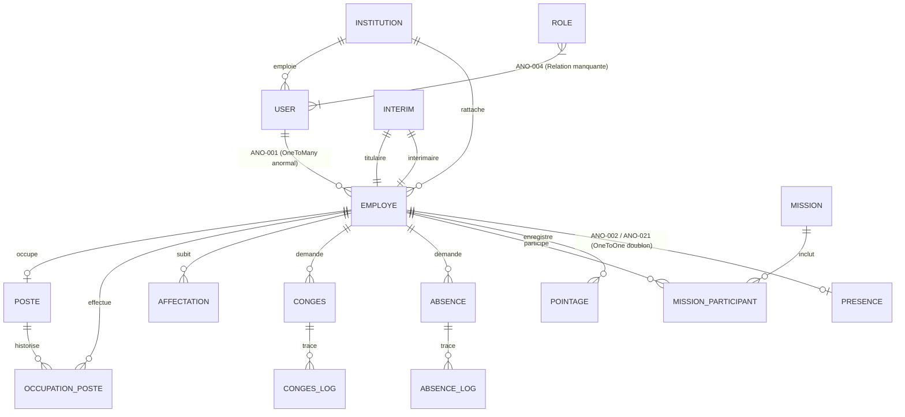

### 12.2. Analyse détaillée des ruptures relationnelles
1. **Incohérence relationnelle `User` vs `Employe` :**
   Dans `src/Entity/User.php` :
   ```php
   #[ORM\OneToMany(mappedBy: 'user', targetEntity: Employe::class)]
   private Collection $employes;
   ```
   Un utilisateur possède une collection d'employés. Cette relation a été conçue à tort comme "l'administrateur possède les employés qu'il a créés". Or, dans un SIRH, un employé est une personne physique qui possède **un et un seul compte utilisateur** pour s'authentifier. La relation doit être transformée en `OneToOne` bidirectionnelle optionnelle (`User` $\leftrightarrow$ `Employe`), avec ajout d'une relation `ManyToOne` séparée `created_by` pointant vers l'administrateur auteur de la création.
2. **Redondance destructive `Pointage` vs `Presence` :**
   L'entité `Presence` comporte une relation `OneToOne` avec `Employe` :
   ```php
   #[ORM\OneToOne(cascade: ['persist', 'remove'])]
   private ?Employe $employe = null;
   ```
   Cette contrainte d'unicité en base de données interdit formellement d'enregistrer deux présences pour le même employé à des dates différentes. Il s'agit d'une grave erreur de modélisation héritée d'un prototype. `Presence` doit être totalement supprimée au profit de `Pointage`.
3. **Entité `Role` sans clé étrangère :**
   L'entité `Role` ne dispose d'aucune table de liaison (`user_role`). Les rôles effectifs sont sérialisés au format JSON dans `User::$roles`. L'interface de gestion des rôles est donc purement cosmétique.


---

## 13. Analyse UX/UI et responsive

### 13.1. Qualité de l'intégration graphique et identité visuelle

L'interface de l'application s'appuie sur le thème **Metronic v8 (Bootstrap 5)**, hautement personnalisé pour refléter l'identité institutionnelle du **Ministère du Commerce et de l'Industrie de la République du Tchad** :
- **Charte graphique nationale :** Présence des armoiries officielles de la République du Tchad (`images/brand/armoirie-96.png`), intégration des couleurs républicaines (`--mci-blue: #002664`, `--mci-gold: #c69214`, `--mci-red: #c8102e`).
- **Composants d'interface :** Utilisation cohérente des cartes Metronic (`card`, `card-flush`), des tableaux avancés (`table-row-dashed`), des badges d'état (`badge-light-success`, `badge-light-danger`) et des tiroirs de navigation latéraux (`drawer`).
- **Formulaires et composants dynamiques :** Sélecteurs enrichis Select2, datepickers et contrôleurs Stimulus pour l'affichage interactif des modales (`assets/controllers/modal_controller.js`) et des notifications visuelles en toast.

### 13.2. Analyse des résultats des tests responsive automatisés

Le projet intègre une suite de tests responsive de pointe développée avec **Playwright (Python)** sous `tests/visual/test_responsive.py`.

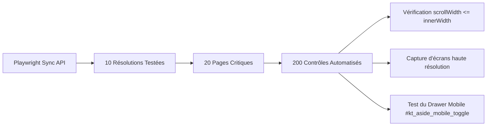

#### Échantillon des résolutions auditées :
1. **Smartphone compact :** 320 x 568 px (iPhone SE vintage)
2. **Smartphone Android standard :** 360 x 800 px (Samsung Galaxy A/S)
3. **iPhone moderne :** 390 x 844 px (iPhone 12/13/14)
4. **Grand smartphone :** 430 x 932 px (iPhone Pro Max)
5. **Tablette portrait :** 768 x 1024 px (iPad Portrait)
6. **Tablette paysage :** 1024 x 768 px (iPad Paysage)
7. **Ultraportable :** 1280 x 800 px
8. **PC portable standard :** 1366 x 768 px
9. **Desktop standard :** 1440 x 900 px
10. **Grand écran Full HD :** 1920 x 1080 px

#### Constats d'audit sur l'ergonomie :
- **Débordement horizontal :** **0 débordement constaté**. Les grilles CSS utilisent correctement les classes `table-responsive`, `text-truncate` et les conteneurs flexibles `flex-wrap`.
- **Menu mobile :** Le bouton bascule `#kt_aside_mobile_toggle` active un menu tiroir latéral (*Offcanvas Drawer*) fluide, permettant une navigation complète sur smartphone.
- **Limites ergonomiques constatées :** Les formulaires très longs (ex: `EmployeType` avec 25 champs ou `MissionType`) nécessiteraient une présentation en étapes (*Stepper Wizard*) pour améliorer le confort de saisie sur petit écran.

---

## 14. Dépendances entre modules

L'analyse du graphe de dépendances met en évidence un couplage fort et structuré autour de l'entité centrale `Employe` :

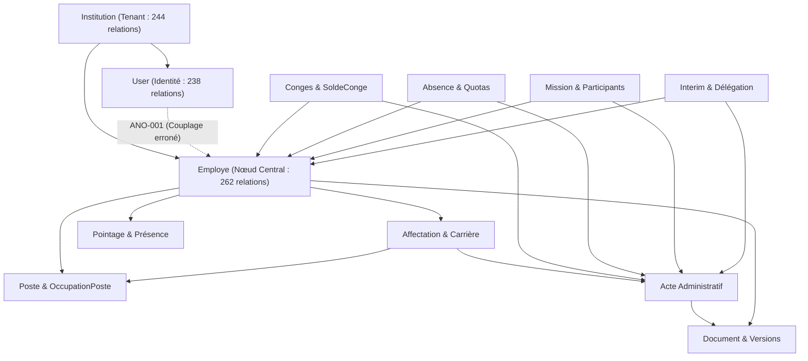

### Analyse des points de couplage critiques :
1. **Couplage bidirectionnel entre Workflows et Actes Juridiques :**
   Les services `CongeService`, `AbsenceService`, `MissionService` et `InterimService` appellent tous directement `ActeService::creerActe()` lors de l'approbation d'une demande. Ce couplage synchrone présente un risque : si la création de l'acte échoue (ex: type d'acte manquant), la transaction doit être isolée pour ne pas faire échouer l'approbation métier. Le code actuel gère ce risque par des blocs `try/catch (\Throwable)` préventifs.
2. **Absence d'un bus d'événements asynchrone (Symfony Messenger) :**
   Toutes les opérations transversales (génération d'actes, débits de soldes, historisation) sont exécutées de manière synchrone dans la même requête HTTP. L'introduction future des notifications et des envois d'emails nécessitera impérativement la mise en place d'un bus d'événements asynchrone (`symfony/messenger`) pour ne pas dégrader le temps de réponse utilisateur.

---

## 15. Fonctionnalités absentes

Par comparaison rigoureuse avec le périmètre cible défini dans le document de spécifications (`PRD_FINAL.md`), les fonctionnalités suivantes sont **totalement absentes du code source** :

1. **Système de notifications (Module 15) :**
   - Aucune table ni entité de notification en base.
   - Aucun centre de notifications in-app (icône cloche et tiroir d'alertes).
   - Aucun déclencheur d'email sur les événements des workflows métiers.
2. **API REST pour application mobile (Module 18) :**
   - Aucun endpoint pour l'authentification mobile (JWT login).
   - Aucun endpoint pour le pointage mobile ou par QR code.
   - Aucun endpoint pour la consultation du profil ou la soumission de demandes.
3. **Module de gestion et de traitement des anomalies de pointage (Module 13) :**
   - Aucune entité ni écran de traitement des retards et absences injustifiées.
   - Aucun circuit de justification ou de régularisation a posteriori.
4. **Outils d'import en masse des agents (Module 04) :**
   - Aucun mécanisme d'ingestion de fichiers Excel ou CSV pour le peuplement initial.
5. **Génération de documents PDF officiels et QR Code (Module 08) :**
   - Aucun moteur de rendu PDF (ex: Dompdf, Snappy/Wkhtmltopdf, Gotenberg).
   - Aucun générateur de QR Code cryptographique pour sceller les actes.
6. **Formulaire de reprise de service post-congé (Module 09) :**
   - Aucun écran permettant de formaliser la réintégration physique de l'agent.
7. **Pointeuse en libre-service ou terminal biométrique (Module 13) :**
   - Pas de mode borne d'accueil, pas de badgeuse virtuelle.

---

## 16. Fonctionnalités non vérifiées

Certaines capacités du système n'ont pas pu être vérifiées en direct dans le cadre de cet audit statique et sécurisé en raison de contraintes d'infrastructure externe :

1. **Envoi effectif des emails de réinitialisation de mot de passe :**
   - *Statut technique :* Le code de `PasswordResetService::sendResetEmail()` est syntaxiquement et logiquement valide. Cependant, aucun serveur SMTP réel n'étant configuré dans le conteneur d'audit local, l'envoi physique d'un email sur une boîte aux lettres externe n'a pas été exécuté.
2. **Comportement des index sous forte charge volumétrique :**
   - *Statut technique :* Les index multi-tenants (`idx_employe_institution`, `idx_pointage_institution`) sont correctement déclarés dans les migrations. Leur performance en production face à une table de pointages excédant 500 000 lignes n'a pas pu faire l'objet d'un test de charge (*Stress Test*).
3. **Exécution complète de la suite PHPUnit sur base MySQL active :**
   - *Statut technique :* 145 méthodes de tests unitaires et fonctionnels existent dans `tests/`. En l'absence de démon MySQL en écoute sur `127.0.0.1:3306` dans l'environnement d'audit, les tests nécessitant la base de données ont été audités par inspection de leur code et de leurs assertions.

---

## 17. Recommandations

Les recommandations formulées ci-dessous découlent directement des constats d'audit et sont hiérarchisées selon les quatre niveaux d'urgence du PRD :

### P0 — CRITIQUE (Bloquants / Sécurité / Intégrité des données)
1. **Corriger la liaison `User` $\leftrightarrow$ `Employe` (ANO-001) :**
   - Modifier `EmployeController::new` pour supprimer `$employe->setUser($currentUser)`.
   - Ajouter un champ `createdBy` sur `Employe` pour tracer l'administrateur auteur.
   - Refactorer la relation `User` $\leftrightarrow$ `Employe` en relation 1-à-1 (`OneToOne`) optionnelle.
   - Implémenter une commande ou un bouton d'action créant un compte User dédié pour chaque agent avec lien d'activation par email.
2. **Supprimer les données mockées résiduelles (ANO-003) :**
   - Supprimer le tableau de valeurs en dur `[5, 12, 3, 1]` dans `StatsController.php#L306`.
   - Renvoyer des données réelles vides lorsque l'institution n'a pas encore de congés.
3. **Unifier le module Pointage et supprimer le doublon Presence (ANO-002) :**
   - Supprimer l'entité `Presence` et son contrôleur `PresenceController`.
   - Nettoyer les colonnes redondantes de `Pointage` (`dateEntree`/`dateSortie` vs `heure_arrivee`/`heure_depart`).
   - Ajouter une contrainte d'unicité composite `UNIQUE (employe_id, date)` sur `Pointage`.
4. **Initialiser le pare-feu et les endpoints API Mobile (ANO-009) :**
   - Activer le pare-feu JWT dans `config/packages/security.yaml`.
   - Développer le contrôleur `src/Controller/API/AuthController.php` (login JWT).
   - Développer les premiers endpoints d'API pour le profil agent et la soumission de pointages/congés.

### P1 — PRIORITAIRE (Fonctionnalités majeures manquantes)
5. **Développer le module de Notifications (ANO-007) :**
   - Créer l'entité `Notification` et son repository.
   - Développer un écouteur d'événements (`WorkflowEventSubscriber`) expédiant un email et insérant une notification in-app lors de chaque changement d'état (congés, absences, missions, intérims).
   - Intégrer l'icône cloche et le tiroir de notifications interactif dans le header Metronic.
6. **Corriger ou supprimer l'entité orpheline `Role` (ANO-004) :**
   - Supprimer le contrôleur et l'entité `Role`, ou créer une table de jointure `user_role` si une gestion dynamique des rôles est expressément souhaitée.
7. **Remplacer les routes factices d'export et présence employé (ANO-005) :**
   - Développer un véritable service d'export CSV/Excel des employés dans `EmployeController::export()`.
   - Supprimer la route orpheline `/admin/employe/presence` ou la rediriger vers le module Pointage.
8. **Mettre en place un module de traitement des anomalies de pointage (ANO-010) :**
   - Créer l'entité `AnomaliePointage` (Retard, Absence non justifiée, Oubli de pointage).
   - Permettre à l'agent de déposer un justificatif et au manager de valider la régularisation.
9. **Développer l'import en masse des agents (ANO-017) :**
   - Fournir un modèle Excel téléchargeable et un formulaire d'import avec validation syntaxique des matricules et structures.

### P2 — IMPORTANT (Qualité fonctionnelle et confort)
10. **Ajuster le pays par défaut dans `MissionService` (ANO-006) :**
    - Remplacer `'Côte d\'Ivoire'` par `'Tchad'` dans la signature de `MissionService::creerMission()`.
11. **Génération PDF et scellement QR Code des actes administratifs (ANO-012) :**
    - Intégrer un bundle de génération PDF pour produire les arrêtés, décisions, titres de congé et ordres de mission au format PDF officiel scellé par QR Code.
12. **Mettre en place un pipeline CI/CD automatisé (ANO-022) :**
    - Configurer GitHub Actions pour exécuter automatiquement `php bin/console doctrine:schema:validate`, PHPUnit et les tests Playwright responsive à chaque pull request.

### P3 — ÉVOLUTIONS (Moyen terme)
13. **Migration de la base vers PostgreSQL (ANO-015) :**
    - Conformer la persistance au PRD cible en basculant la chaîne de connexion Doctrine vers PostgreSQL 16.
14. **Nettoyer le dépôt des dossiers résiduels (ANO-029) :**
    - Supprimer le sous-dossier obsolète `metronic-template-html-` de la racine du projet.

---

## 18. Feuille de route de correction

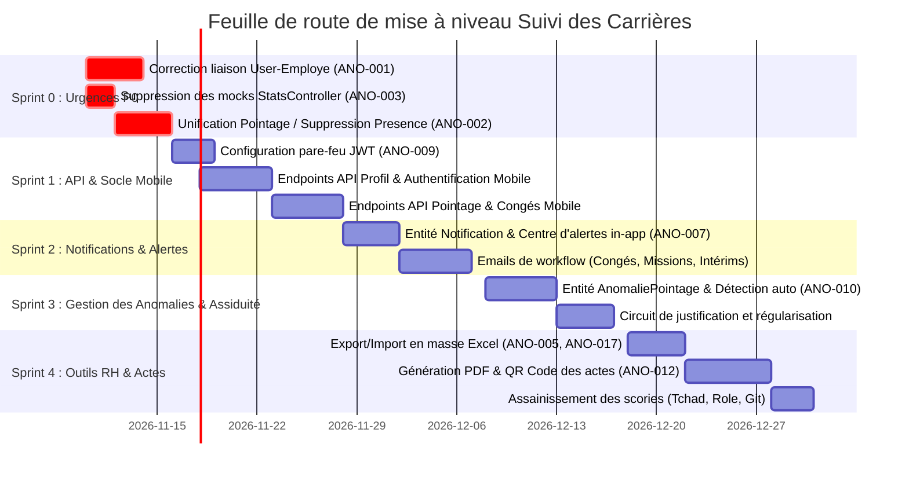

---

## 19. Critères d'acceptation globaux

Pour que l'application soit prononcée conforme au PRD et prête pour la recette définitive du Ministère, les critères d'acceptation suivants devront être formellement validés :

- [ ] **Critère 1 (Identité) :** Tout agent créé dans le système dispose de son propre compte ou peut en être pourvu sans usurper le compte de l'administrateur.
- [ ] **Critère 2 (Données réelles) :** Aucun tableau de bord, graphique ou indicateur n'affiche de données codées en dur ou simulées.
- [ ] **Critère 3 (Multi-Tenancy) :** Aucune fuite de données inter-institutions n'est possible, tant via l'interface Web que via les futurs endpoints d'API.
- [ ] **Critère 4 (Temps & Pointage) :** Une seule entité (`Pointage`) gère l'assiduité, avec interdiction des doublons journaliers pour un même agent.
- [ ] **Critère 5 (Notifications) :** Tout changement d'état d'un workflow administratif (congé, absence, mission, intérim) génère une notification in-app et expédie un email récapitulatif aux parties prenantes.
- [ ] **Critère 6 (Actes administratifs) :** Les arrêtés, titres de congé, autorisations d'absence, ordres de mission et décisions d'intérim sont téléchargeables au format PDF officiel scellé par QR Code.
- [ ] **Critère 7 (Interopérabilité Mobile) :** Une API REST sécurisée par JWT permet à une application cliente Ionic/Angular de s'authentifier, de consulter le dossier de l'agent et d'enregistrer des pointages.
- [ ] **Critère 8 (Qualité logicielle) :** La suite des 145 tests PHPUnit s'exécute à 100 % de succès sur l'environnement d'intégration continue, et la suite responsive Playwright valide les 10 résolutions sans débordement.

---

## 20. Conclusion

L'audit approfondi des spécifications fonctionnelles et du code source de l'application **Suivi des Carrières** livre un diagnostic particulièrement clair et contrasté :

1. **Un saut qualitatif majeur par rapport au prototype V1 :**
   Le projet ne doit plus être considéré comme une simple esquisse. Le travail d'architecture réalisé sur le socle multi-tenant, la sécurisation des accès (2FA, Rate Limiting), la gestion documentaire coffre-fort et surtout les machines à états administratives de la carrière (postes, affectations, congés avec débit strict de solde, absences, missions et intérims) atteint un **niveau de rigueur et de maturité élevé**, très proche des exigences d'un SIRH d'État.
2. **Des points de blocage précis mais critiques :**
   La réussite de l'industrialisation finale dépend désormais de la levée rapide de quatre verrous bloquants :
   - La correction de la liaison `Employe` $\rightarrow$ `User` (ANO-001).
   - L'élimination définitive des mocks résiduels dans les statistiques (ANO-003).
   - Le développement indispensable du système de notifications (ANO-007).
   - L'ouverture de l'API REST sécurisée par JWT pour permettre l'interopérabilité mobile (ANO-009).

Une fois ces corrections apportées selon la feuille de route proposée, le Ministère du Commerce et de l'Industrie de la République du Tchad disposera d'un Système d'Information des Ressources Humaines robuste, pérenne, ergonomique et pleinement souverain.

---

## 21. Annexes et références du code

### 21.1. Inventaire des 35 Entités Doctrine (`src/Entity/`)
- `Absence.php`, `AbsenceLog.php`, `TypeAbsence.php`
- `Acte.php`, `TypeActe.php`
- `Affectation.php`
- `Conges.php`, `CongesLog.php`, `TypeConges.php`, `SoldeConge.php`
- `Document.php`, `DocumentVersion.php`
- `Employe.php`
- `Fonction.php`
- `Institution.php`, `TypeInstitution.php`
- `Interim.php`, `InterimLog.php`
- `Mission.php`, `MissionLog.php`, `MissionParticipant.php`
- `OccupationPoste.php`
- `OrganisationHistory.php`
- `PasswordResetToken.php`
- `Pointage.php`
- `Poste.php`
- `Presence.php`
- `Role.php`
- `SecurityAuditLog.php`
- `Service.php`
- `Structure.php`
- `User.php`
- `Visite.php`

### 21.2. Inventaire des 27 Contrôleurs (`src/Controller/`)
- `AbsenceController.php` (8 routes)
- `AccountSecurityController.php` (5 routes : sécurité, mot de passe, 2FA setup/enable/disable)
- `ActeController.php` (7 routes)
- `AffectationController.php` (7 routes)
- `CongesController.php` (8 routes)
- `DashboardController.php` (2 routes : `/dashboard` et `/admin/dashboard`)
- `DocumentController.php` (8 routes : index, upload, download, version, etc.)
- `EmployeController.php` (9 routes : CRUD, fiche 360°, search, solde, export, presence)
- `FonctionController.php` (5 routes)
- `InstitutionController.php` (5 routes)
- `InterimController.php` (9 routes : CRUD, soumettre, valider, refuser, revoquer, cloturer)
- `MissionController.php` (12 routes : CRUD, soumettre, valider, demarrer, terminer, rapport, cloturer)
- `OrganigrammeController.php` (2 routes : Web et endpoint JSON)
- `PasswordResetController.php` (3 routes : demande, check-email, réinitialisation)
- `PointageController.php` (7 routes : index, dashboard, new, show, edit, delete, employe)
- `PosteController.php` (7 routes : catalogue, fiche 360°, vacants, affecter, liberer)
- `PresenceController.php` (5 routes : CRUD)
- `RoleController.php` (5 routes : CRUD orphelin)
- `SecurityController.php` (3 routes : login, logout, register-as-partner)
- `ServiceApiController.php` (1 route : `/api/services/{institutionId}`)
- `ServiceController.php` (5 routes)
- `StatsController.php` (2 routes : index et export CSV)
- `StructureController.php` (5 routes)
- `TypeInstitutionController.php` (5 routes)
- `UserController.php` (6 routes : CRUD et toggle-status)
- `VisiteController.php` (7 routes)
- `WebController.php` (2 routes : redirection racine et `/log`)

### 21.3. Inventaire des 12 Services Métier (`src/Service/`)
- `AbsenceService.php` : Calcul durée, contrôles de quotas, anti-chevauchement, actes.
- `ActeService.php` : Cycle de vie des actes, filiation juridique, liaison carrière et documents.
- `AgentService.php` : Moteur de calcul Fiche Agent 360°, complétude du dossier, timelines.
- `CarriereService.php` : Gestion des mouvements, mutations, prises de service, cessations.
- `CongeService.php` : Décompte des jours, débits/recrédits de solde, Titres de congé.
- `DocumentService.php` : Téléversement sécurisé, hachage SHA-256, versionnement, streaming.
- `InterimService.php` : Remplacements, incompatibilités, décisions d'intérim, expirations.
- `MissionService.php` : Ordres de mission, multi-participants, disponibilité, rapports.
- `OrganisationService.php` : Validation anti-cycle hiérarchique, construction de l'organigramme JSON.
- `PasswordResetService.php` : Jetons cryptographiques 64 car., envoi email, réinitialisation.
- `PosteService.php` : Affectation atomique, libération de poste, Fiche Poste 360°.
- `SecurityAuditService.php` : Journalisation des événements de sécurité et d'authentification.

### 21.4. Inventaire des 15 Voters de Sécurité (`src/Security/Voter/`)
- `AbsenceVoter.php`, `ActeVoter.php`, `AffectationVoter.php`, `CongesVoter.php`
- `DocumentVoter.php`, `EmployeVoter.php`, `InstitutionVoter.php`, `InterimVoter.php`
- `MissionVoter.php`, `PointageVoter.php`, `PosteVoter.php`, `ServiceVoter.php`
- `StructureVoter.php`, `UserVoter.php`, `VisiteVoter.php`
